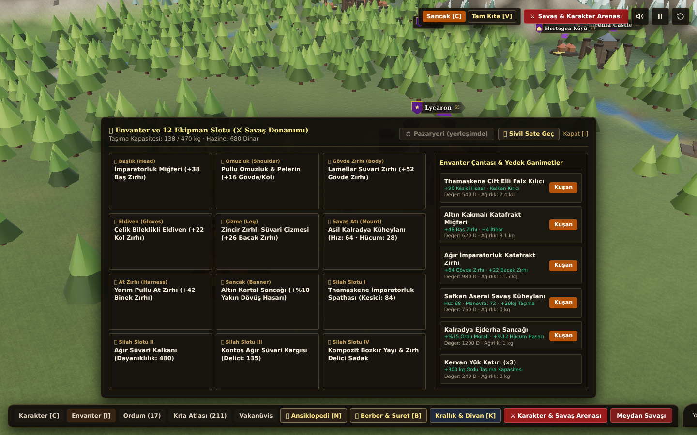
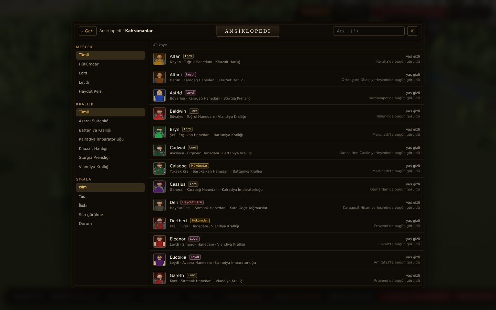
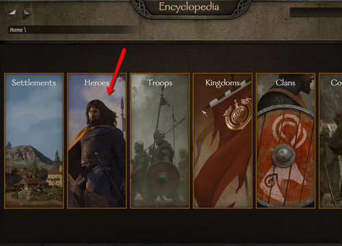
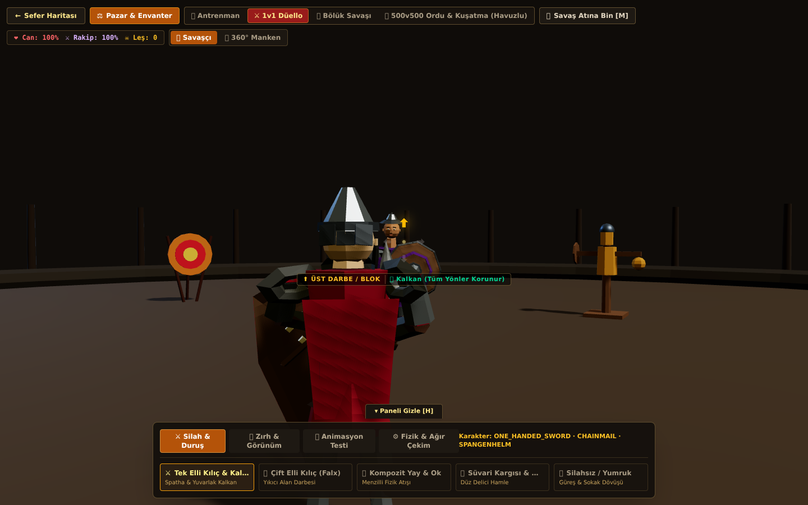
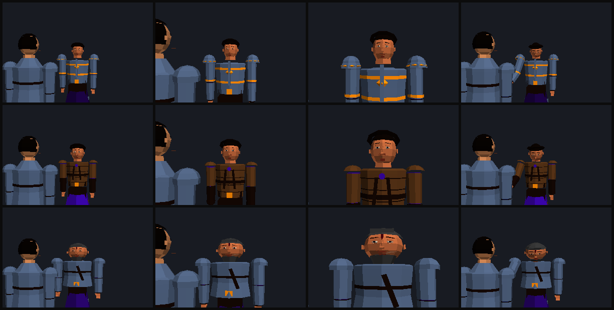
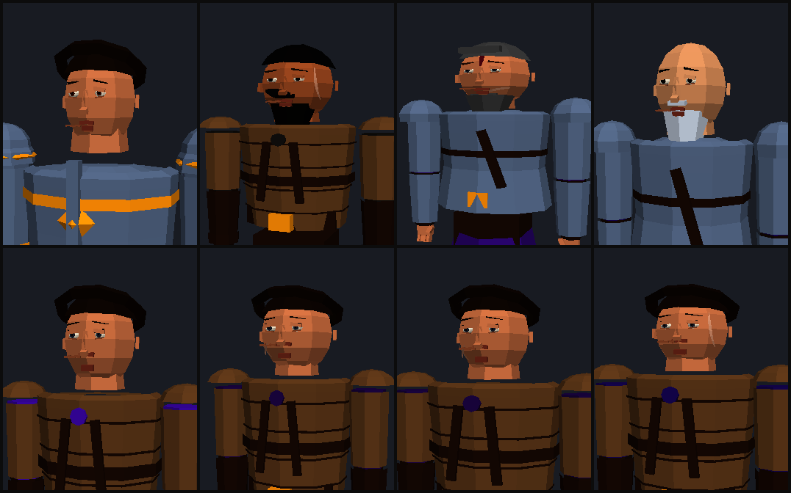
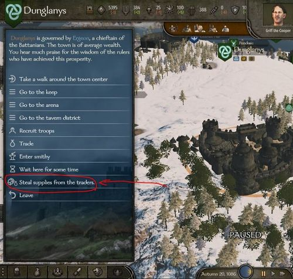

# ⚔️ BANNERLORD ↔ SANCAK-I KALRADYA — TAM KARŞILAŞTIRMA, DOSYA KARNESİ VE YOL HARİTASI

> **Rapor tarihi:** 21 Ekim 2026 · **Sürüm:** Faz 10b sonrası (`cc3fee4`)
> **Kapsam:** 62 kaynak dosya / 47.912 satır TypeScript + 43 test-render betiği
> **Yöntem:** Kod okuma + otomatik doğrulama (`tsc`, 28 birim testi, 29 probe paketi, `vite build`)
> + **metin araştırması** (TaleWorlds blog, fandom, Steam/namu wiki, rehberler)
> + **görsel araştırma**: 8 Bannerlord referans ekranı (`docs/renders/reference/`) ↔ bizim 5 karemiz
> (`docs/renders/`) yan yana incelendi (bkz. §7.0)

---

## 0. TEK SAYFADA ÖZET (yönetici özeti)

| Soru | Kısa cevap |
| :--- | :--- |
| **Genel olarak neredeyiz?** | **Mühendislik 6,1 / 10** · **Oyun deneyimi 5,3 / 10** · Bannerlord referansı 9,1 / 10 → **Bannerlord'un ~%67 mühendislik, ~%58 deneyim seviyesi** |
| **En güçlü olduğumuz yer** | Sıfırdan yazılmış 3B motor (iskelet, IK, dövüş, 1000 asker havuzu), 211 yerleşimli prosedürel harita, kararlı kayıt + 29 problu test disiplini |
| **En zayıf olduğumuz yer** | **Canlı dünya simülasyonu yok** (lord AI devriye gezmekten öteye geçmiyor), **içerik çeşitliliği çok düşük** (4 asker tipi, 29 eşya, 12 NPC repliği) |
| **Görsel olarak neredeyiz?** | Düzen/yerleşim **≈%85 doğru**, yüzey işçiliği (parşömen, illüstrasyon, ikon) **≈%30** → görsel ortalama **5,6 / 10** |
| **"Bannerlord gibi" hissi veren kısım** | Arayüz dili, ansiklopedi, pazar, yerleşim menüsü, dövüş mekaniği |
| **"Bannerlord gibi" hissettirmeyen kısım** | Dünya sana tepki vermiyor: lordlar peşine düşmüyor, kuşatmıyor, savaş ilan etmiyor; her lord aynı 12 cümleyi kuruyor |
| **Profesyonel oynanabilir seviyeye ne zaman?** | **Dikey dilim (demo): 8–10 hafta → Ocak 2027** · **Satılabilir erken erişim: ~9 ay → Temmuz 2027** · **Bannerlord'a rakip: gerçekçi değil (yıllar + ekip)** |
| **Tek bir cümle** | *"Çok iyi bir motor ve arayüz iskeleti; henüz oyunun kendisi (dünya, insanlar, hikâye) yok."* |

### Puan dağılımı (dosya bazlı)

| Aralık | Dosya sayısı | Yorum |
| :--- | :---: | :--- |
| 9–10 (mükemmel) | **0** | Henüz hiçbir dosya "Bannerlord sınıfı" değil |
| 8–9 (çok iyi) | **10** | `ik.ts`, `saveGame.ts`, `uiSession.ts`, `tacticalFormation.ts`, `icons.tsx`, `FactionCrest.tsx`, `mapGen.ts`, `characterRig.ts`, `parts.tsx`, `rules.test.ts` |
| 7–8 (iyi) | **40** | Teknik olarak temiz, ürünleşmemiş |
| 6–7 (orta) | **8** | God-component'ler ve çift kaynaklar |
| < 6 (zayıf) | **4** | `dialogue.ts` 4,5 · `campaignSystem.ts` 5,5 · `quests.ts` 5,5 · `ConversationCanvas.tsx` 5,5 |
| **Ortalama** | **7,16 / 10** | Dağılım çok düz: vasat-altı yok, ama zirve de yok |

---

## 1. NASIL ÖLÇTÜM (şeffaf yöntem)

### 1.1 Ham ölçümler (bu raporda kullanılan gerçek sayılar)

| Ölçüm | Değer | Komut / kaynak |
| :--- | :--- | :--- |
| Kaynak dosya | **62** (42 `.ts`, 20 `.tsx`) | `find src -name "*.ts*"` |
| Toplam satır | **47.912** | `wc -l` |
| En büyük 5 dosya | `rules.ts` 3.619 · `CharacterArenaView.tsx` 2.936 · `Armory.ts` 2.930 · `WorldCanvas.tsx` 2.657 · `characterRig.ts` 1.995 | `wc -l` |
| Üretim paketi | **1.566 kB** (gzip 437 kB), tek chunk | `vite build` |
| Tip denetimi | `tsc --noEmit` **0 hata** · `tsc --strict` **0 hata** · `--noUnusedLocals` **78 hata** | `npx tsc` |
| Birim testi | **28 test / 267 doğrulama** | `rules.test.ts` |
| Prob paketi | **29** (hepsi ✅) | `npm run verify:all` |
| Test/araç betiği | **43** | `ls scripts` |
| Yerleşim | **211** (51 şehir / 29 kale / 131 köy) | `probe-content.ts` |
| Kahraman / klan / krallık | **40 / 21 / 8** | `probe-heroes.ts` |
| Asker tipi | **4** (`militia, archer, cavalry, guard`) | `rules.ts:26` |
| Pazar eşyası | **29** | `marketRules.ts` |
| Beceri / nitelik / perk | **18 / 6 / 0** | `rules.ts:71-98` |
| Görev türü | **5** | `quests.ts:16` |
| Diyalog | **12 NPC repliği + 16 oyuncu seçeneği** (tüm lordlar için ortak şablon) | `dialogue.ts` |
| Bina / günlük politika / atölye / kuşatma makinesi | **6 / 4 / 4 / 5** | `rules.ts` |
| Ses | ~15 prosedürel efekt, **müzik yok**, seslendirme yok | `sound.ts` |
| `any` kullanımı / TODO | **3 / 0** | `grep` |

### 1.2 Bannerlord referans değerleri

| Kalem | Bannerlord | Kaynak |
| :--- | :--- | :--- |
| Yerleşim | **≈53 şehir, ≈67 kale, ≈270 köy** (≈390) | [gamepressure](https://www.gamepressure.com/newsroom/bannerlord-helpful-map-of-resources-and-goods/z61b0c), [Fandom Towns](https://mountandblade.fandom.com/wiki/Towns_(Bannerlord)) |
| Asker ağacı | **6 kültür hattı × Tier 1–6 × 4–5 dal** (~100+ birlik) | [Gamer Empire](https://gamerempire.net/mount-blade-2-bannerlord-troop-trees-guide/) |
| Beceri / perk | 6 nitelik · 18 beceri · **~250+ perk** | `docs/BANNERLORD_COMPLETE_SYSTEMS_ENCYCLOPEDIA.md` Bölüm 3 |
| Yerleşim bölgeleri | 7 (Marketplace, Tavern, Arena, Keep, Military, Dungeon, **Slums**) | [TaleWorlds Blog/85](https://www.taleworlds.com/en/Games/Bannerlord/Blog/85) |
| Menü biçimi | Harita üzerine binen overlay + bölge alt menüleri + sağ üst NPC paneli | [TaleWorlds Blog/67](https://www.taleworlds.com/en/Games/Bannerlord/Blog/67) |
| Kale adlandırma (TR) | "Lochana Kalesi" · şehir/köy yalın | Steam TR yerelleştirme rehberi |

> **Not:** Bannerlord'un kendi içerik hacmi (diyalog, eşya, görev, ses) burada tek tek sayılmadı;
> ölçülemeyen yerlerde "binlerce / yüzlerce" gibi ihtiyatlı ifade kullandım.

---

## 2. SİSTEM SİSTEM KARŞILAŞTIRMA (20 başlık, ağırlıklı karne)

| # | Sistem | Ağırlık | Biz | Bannerlord | Oran | Durum |
| :-: | :--- | :-: | :-: | :-: | :-: | :--- |
| 1 | Sefer haritası, coğrafya, navigasyon | %8 | **7,5** | 9,5 | %79 | 🟢 |
| 2 | **Kampanya simülasyonu (lord AI, savaş/barış, kuşatma)** | %12 | **3,5** | 9,5 | **%37** | 🔴 |
| 3 | Yerleşim ekonomisi ve pazar | %8 | 6,5 | 9,0 | %72 | 🟡 |
| 4 | Yerleşim menüleri ve etkileşimler | %6 | 7,0 | 9,0 | %78 | 🟢 |
| 5 | Savaş alanı (1000 asker, kuşatma) | %10 | 7,0 | 9,5 | %74 | 🟡 |
| 6 | Oyuncu dövüşü (4 yön, blok, yay) | %10 | **8,0** | 9,0 | %89 | 🟢 |
| 7 | Karakter görselleri ve animasyon | %8 | 6,5 | 9,0 | %72 | 🟡 |
| 8 | Envanter ve pazar arayüzü | %5 | 7,5 | 9,0 | %83 | 🟢 |
| 9 | Ansiklopedi | %5 | 7,5 | 9,0 | %83 | 🟢 |
| 10 | **Diyalog ve ikna** | %7 | **4,0** | 9,0 | **%44** | 🔴 |
| 11 | Görevler (quest) | %5 | 5,0 | 8,5 | %59 | 🟠 |
| 12 | Krallık, klan ve diplomasi | %6 | 6,5 | 9,0 | %72 | 🟡 |
| 13 | Yetenek, nitelik, gelişim | %4 | 6,0 | 9,0 | %67 | 🟡 |
| 14 | **Ses ve müzik** | %3 | 4,5 | 9,5 | **%47** | 🔴 |
| 15 | Arayüz/UX tutarlılığı, erişilebilirlik | %5 | 6,0 | 9,0 | %67 | 🟡 |
| 16 | Teknik mimari ve test | %6 | 7,5 | 9,0 | %83 | 🟢 |
| 17 | Performans | %5 | 7,0 | 9,0 | %78 | 🟡 |
| 18 | **İçerik çeşitliliği** | %7 | **3,0** | 9,5 | **%32** | 🔴 |
| 19 | Kalıcılık (kayıt/yükleme) | %3 | 8,5 | 9,0 | %94 | 🟢 |
| 20 | Yerelleştirme / mobil / çok oyunculu | %2 | 3,0 | 8,0 | %38 | 🔴 |
| | **AĞIRLIKLI TOPLAM** | %125 | **6,12** | **9,12** | **%67** | |

### 2.1 Oyun deneyimi ağırlığıyla ikinci ölçüm (daha acımasız, daha dürüst)

Mühendislik ağırlığı yukarıdaki tablo. Ama oyuncu "sistem var mı" diye değil, "eğleniyor muyum" diye bakar.
Deneyim ağırlıkları (kampanya %18, çeşitlilik %14, diyalog %10, savaş %20, ekonomi %6, görsel %6, ses %4 …):

| Ölçüm | Puan |
| :--- | :---: |
| **Mühendislik karnesi** (yukarıdaki tablo) | **6,12 / 10** |
| **Oyun deneyimi karnesi** (oyuncu gözü) | **5,25 / 10** |
| Bannerlord referansı | 9,12 / 10 |

> Farkın sebebi tek cümleyle: **sistemler var, hayat yok.** 1000 asker sahada çarpışıyor ama o askerleri
> sahaya süren bir savaş sebebi, o savaşı başlatan bir lord, o lordu ikna eden bir diyalog yok.

### 2.2 Derinlemesine: en kritik 10 sistem

#### ① Sefer haritası ve coğrafya — 7,5 (Bannerlord 9,5)

**Bizde olan:** 2400×1800 birim kesintisiz kıta (`mapGen.ts`), 6 krallık biyomu, sıradağlar,
nehir ağları, taş köprüler, kervan yolları, 211 yerleşim için düzleştirilmiş vadi terasları.
A* kara rotalama (`navigation.ts`) deniz/göl geçişini engelliyor, köprü/berzah kullanıyor.
Kamera: logaritmik tekerlek zoom, C2 sürekli eğri, etiket projeksiyonu (`WorldCanvas.tsx`).
Hareket hızı Bannerlord `DefaultPartySpeedCalculatingModel`'e benzetilmiş (`campaignSystem.ts`).

**Bannerlord'da ayrıca olan:** Harita üzerinde **karavan ticareti**, **haydut sığınakları (hideout)**,
**köy üretim ikonları**, **yol/geçit stratejisi**, **mevsimsel görsel değişim**, harita üzerinde
**lord orduları (army) birleşmesi**, sis/keşif haritası (bizde kısmi).

**Fark:** Coğrafya ve kamera neredeyse akran; **haritayı canlı tutan aktörler** eksik.
Harita "güzel bir diorama", "yaşayan bir dünya" değil.

#### ② Kampanya simülasyonu — 3,5 (Bannerlord 9,5) 🔴 EN BÜYÜK EKSİK

**Bizde olan:** `advanceDailyEconomyAndWorld()` her gün **her yerleşime +2 refah, +3 erzak, sabit
asker havuzu** ekliyor; oyuncu vergisi `refah × 0.25`; moral ±. Lordlar
`stepLordCampaignRoute()` ile **konumdan türetilmiş bir hash ile rastgele yerleşim seçip oraya
yürüyor**, sonra bir sonraki yerleşimi seçiyor.

**Kanıt (kod):**

```ts
// campaignSystem.ts — yeni hedef seçimi
const pickIdx = Math.abs(Math.floor(route.x * 13 + route.z * 17 + lord.armySize * 7)) % pool.length;
route.currentAction = lord.faction === 'bandits' ? `${dest.name} civarında kervan kolluyor` : …
```

**Bannerlord'da olan:** Her lordun **stratejik hedefi** var (savun, kuşat, ordu topla, köy yağmala,
düşman lordu avla, şehre sığın). Krallıklar **savaş ilan eder**, **barış yapar**, **ordu (army)**
kurar, **kuşatma** başlatır, **fiefleri el değiştirir**, klanlar **krallıktan ayrılır**, krallıklar
**çöker**. Oyuncu haritada **avlanır**, kaçarken **yakalanır**.

**Bizde yok:** savaş ilanı, barış, kuşatma başlatma, ordu birleşmesi, oyuncuyu takip etme,
lordlar arası savaş, yerleşim el değiştirmesi (fetih yalnız oyuncunun savaşını kazanmasıyla).

**Neden kritik:** Bu sistem olmadan diğer her şey "sahne" olarak kalıyor. **Ölçtüm** —
365 günlük (1 yıl) simülasyon, hiç oyuncu müdahalesi olmadan:

| Ölçüm | Sonuç | Yorum |
| :--- | :--- | :--- |
| Sahiplik değiştiren yerleşim | **0 / 211** | Dünya haritası bir yıl sonra **birebir aynı** |
| Refah artışı (ortalama) | **+622** (min +309, maks +730) | Her yerleşim aynı hızda, tek yönlü büyüyor (tavan 999) |
| Oyuncu altını | **24.555 Dinar** | Ekonomi tek yönlü: 1 yılda hiçbir şey yapmadan 24 bin dinar |
| Ordu | 17 asker (sabit) | Asker kaybı/kaçağı yok |
| Moral | **15** (taban) | Erzak bittiği için sürekli ceza; ordu asla dağılmıyor |
| Vakayiname (chronicle) | **3 kayıt** | Dünya **hiç olay üretmiyor** |

Bu tablo tek başına raporun en önemli bulgusudur: **"yaşayan dünya" şu anda bir dekor.**

**Nasıl yapılır (öneri):** `kingdomSystem.ts`'te hazır bekleyen `calculateWarDesireAndTribute`,
`resolveKingdomCouncilVote`, `evaluateStateDrivenKingdomDestruction` fonksiyonları **zaten yazılmış**
ama sadece `KingdomManagementModal` içinden çağrılıyor. Bunları **günlük tick'e** bağlamak
ilk büyük adım (tahmini 3–4 gün). Ardından lordlara 6 durumlu bir FSM ve ordu/kuşatma alt sistemi.

#### ③ Yerleşim ekonomisi ve pazar — 6,5 (Bannerlord 9,0)

**Bizde olan:** `market.ts` refah → fiyat çarpanı (0.82–1.28), tüccar kesesi, stok oranı,
yağma etkisi; `marketRules.ts` 29 eşya, kategori filtreleri, alış/satış, "kaça aldım" hafızası;
atölye (4 tip, günlük gelir), bina projeleri (6 × 3 seviye), günlük politikalar (4), köy üretimi
(`primaryProduction`).

**Bannerlord'da olan:** Her şehirde **birden çok atölye** (oyuncu 3'e kadar sahip olabilir),
**köy→şehir ticaret bağı** (trade bound), **kervanlar**, **gıda tüketimi ve kıtlık**, **işsizlik**,
**notable ekonomisi**, **fiyatların günlük dalgalanması**, **atölye hammadde zinciri**.

**Fark:** Bizde fiyat modeli **statik deterministik** (yerleşim id'si hash'i), günden güne değişmiyor.
Atölye = yerleşim başına **tek slot**. Ekonomi "tablo", "piyasa" değil.

#### ④ Yerleşim menüleri — 7,0 (Bannerlord 9,0)

**Bizde olan:** 12 sekme (Meydan, Kale, Pazaryeri, Meyhane, Arena, Demirci, Mülk Yönetimi,
Gönüllü Asker, Burada Bekle, Kuşatma Kampı, Kuşat ve Taarruz, Zindan/Garnizon) + ileri gelenler
(notable) şeridi + geri bildirim toast'ları. Faz 10b'de emoji → SVG, etiketler Bannerlord gibi
tek sözcüğe indirildi.

**Bannerlord'da olan:** Aynı 7 bölge + **Slums (arka sokaklar)**, **lordlar salonu (giriş rüşveti)**,
**notable'ların güç/seçim sistemi**, **hapishaneden kaçış**, **kuşatma sırasında değişen menü**
(boş sokaklar, barikat), **NPC portre panelinden doğrudan konuşma**.

**Fark:** Yapı %80 doğru; **Slums yok**, notable'lar dekoratif (güç/ilişki ekonomisi yok),
kuşatma durumu menüyü değiştirmiyor.

#### ⑤ Savaş alanı — 7,0 (Bannerlord 9,5)

**Bizde olan:** `battleEnginePool.ts` 10.000 ok + 10.000 ceset + 1.000 asker için `Float32Array`
havuzları, `instancedArmyRenderer.ts` ile InstancedMesh çizimi, `tacticalFormation.ts` ile
piyade/okçu/süvari bölükleri, 4 formasyon, F1–F3 komutları, 3B koçbaşı/kule/mancınık.
Savaş öncesi ön-yükleme ekranı (`BattlePrewarmModal.tsx`).

**Bannerlord'da olan:** Aynı havuz mantığı + **gerçek asker-asker yapay zekâsı** (her asker hedef
seçer, etrafını sarar, geri çekilir), **süvari hücumu/dönüşü**, **okçu menzil yayılımı**,
**moral ve kaçış**, **kuşatmada merdiven-mancınık etkileşimi**, **komuta emri verme (F1–F7)**.

**Fark:** Bizde 1000 asker **havuzda** var; ama askerlerin **bireysel dövüş AI'sı sınırlı**
(`CharacterArenaView` içinde `SKIRMISH` modunda hedef seçimi var, `MASS_BATTLE` havuzunda
ağırlıklı formasyon hareketi). Performans iddiası (5 draw call, 60 FPS) **bu ortamda
doğrulanamadı** — tarayıcı olmadığı için dürüstçe "iddia" olarak işaretliyorum.

#### ⑥ Oyuncu dövüşü — 8,0 (Bannerlord 9,0) 🟢 EN GÜÇLÜ OLDUĞUMUZ YER

4 yönlü saldırı (üst/alt/sol/sağ), blok, feint, kalkan darbesi, basılı tutarak windup,
iki eklemli analitik IK (`ik.ts`), katmanlı animasyon (alt gövde yürürken üst gövde vuruyor),
yay çekme/nişan, parabolik ok fiziği, okları kalkanla bloklama, savaş atı.

**Eksik:** vuruş hissi (hit-stop, ekran sarsıntısı, kan/parçacık yok), silah ağırlığı/ momentum,
kafa vuruşu çarpanları, kalkan kırılması, düşman dövüş AI'sının derinliği, at üstünde dövüş.

#### ⑦ Karakter görselleri ve animasyon — 6,5 (Bannerlord 9,0)

**Bizde olan:** `characterRig.ts` (1.995 satır) tam prosedürel iskelet, 4 miğfer / 4 zırh /
5 silah / 3 kalkan, `characterMorph.ts` DNA tabanlı yüz morfu, `characterFace.ts` yüz katmanı,
baked portre üretimi (`portraitRenderer.ts`).

**Bannerlord'da olan:** Tarama tabanlı yüzler, yüz kasları, ifade, binlerce kıyafet kombinasyonu,
doku atlasları, PBR malzemeler, gerçek animasyon klipleri (mocap).

**Fark:** Bizimki **düz gölgeli (flat shaded), dokusuz low-poly**. Stil olarak tutarlı; ama
oranlar sorunlu (omuzlar aşırı büyük, eller/kafa oranı kaymış) — `docs/renders/conversation.png`
ve `portrait-face.png` bunu net gösteriyor.

#### ⑧ Diyalog ve ikna — 4,0 (Bannerlord 9,0) 🔴

**Bizde olan:** `buildDialogue()` tek bir **şablon grafiği** üretiyor: savaş hâli (3 seçenek),
barış karşılaması, görev, ikna, takas. Toplam **12 NPC repliği + 16 oyuncu seçeneği** — bu metin
**40 kahramanın tamamı** için aynı; yalnız `${name}` değişiyor. Kamera/çerçeveleme
(`conversation.ts`) var, ses yok.

**Bannerlord'da olan:** Her kahramanın **kişiliğine, kültürüne, klanına, ilişkisine göre**
değişen binlerce satır; **4 aşamalı ikna** (her aşamada farklı argüman), **takas (barter)** ekranı,
**lordların ruh hâli**, **seslendirme**.

**Fark:** En büyük "içerik" yarası. Kod altyapısı (graf, etki türleri, doğrulayıcı,
`canExit`, `persuadeChance`) iyi; **içerik yok**.

#### ⑨ Krallık, klan, diplomasi — 6,5 (Bannerlord 9,0)

**Bizde olan:** `kingdomSystem.ts` (1.275 satır) ciddi bir makro model: 5 kişilik trait sistemi,
klan veraseti (naip), savaş isteği/haraç hesabı, tımar talebi seçimi (merit + ballot),
konsey oylaması, krallık çöküş değerlendirmesi, sadakat/gıda formülü, hava + oto-savaş çarpanları,
8 krallık politikası.

**Sorun:** Bu modelin **%90'ı yalnız arayüzde** yaşıyor (`KingdomManagementModal`). Dünya
kendi kendine karar vermiyor; oyuncu madalyonun arkasını görmüyor. A5/A6 denetim bulguları da
(tımar sayılarının uydurma olması, elle yazılmış 6 klan) bu modülün veri tarafının zayıf olduğunu
gösteriyor.

#### ⑩ Ses ve müzik — 4,5 (Bannerlord 9,5) 🔴

**Bizde olan:** `sound.ts` + `BattleSoundFX.ts` (985 satır) ile **sıfır dosyalı prosedürel** kılıç,
kalkan, yay, savaş borusu, zafer/ yenilgi, sikke sesleri. `armorySound.ts` köprüsü.
**Müzik yok, ortam sesi yok, seslendirme yok.**

**Bannerlord:** 2 saatten fazla orkestral müzik, bölgeye göre ortam sesleri, tam seslendirme.

**Fark:** Ses tasarımı "fonksiyonel" seviyede; atmosfer yok. Müzik eklemek görece **ucuz ve
yüksek etkili** bir iyileştirme (aşağıdaki yol haritasında 2. sırada).

---

## 3. DOSYA DOSYA KARNE (62 dosya, 10 üzerinden)

> **Puanlama ölçütü:** (a) işlev derinliği, (b) Bannerlord'a benzerlik, (c) kod kalitesi/tek sorumluluk,
> (d) test edilebilirlik, (e) entegrasyon. **9–10 = Bannerlord sınıfı**, 7 = sağlam ama ürünleşmemiş,
> 5 = iskelet, <5 = sorunlu.

### 3.1 Oyun mantığı (`src/game/`, 31 dosya)

| Dosya | Satır | Puan | Güçlü yanı | Zayıf yanı |
| :--- | --: | :-: | :--- | :--- |
| `rules.ts` | 3.546 | **7,0** | 40+ saf fonksiyon (savaş, pazar, kuşatma, bina, demircilik, ikna, takas); tam test edilebilir | **God module**; `CampaignState` sığ (savaş matrisi, garnizon kompozisyonu, klan mülkiyeti yok); günlük ekonomi naif; savaş sonrası 1.500 satır tek fonksiyonda |
| `rules.test.ts` | 1.112 | **8,0** | 28 test / 267 doğrulama; savaş, pazar, görev, kayıt senaryoları | UI ve AI kapsamı yok; test sayısı sınıra yakın |
| `campaignSystem.ts` | 356 | **5,5** | Bannerlord hız formülü, görüş menzili, lord intel raporu | **Lord AI = devriye dolaşması**; stratejik hedef yok; `Date.now()` ile determinizm bozuluyor |
| `kingdomSystem.ts` | 1.275 | **7,2** | Politikalar, savaş isteği, seçim/oylama, çöküş, sadakat formülü — ciddi makro model | Model yalnız arayüzde çalışıyor; 6 klan elle yazılmış; tımar sayısı uydurma |
| `market.ts` | 236 | **7,5** | Temiz, saf, deterministik fiyat modeli (refah/jitter/yağma) | Günlük fiyat dalgalanması yok; kervan/ticaret bağı yok |
| `marketRules.ts` | 580 | **7,5** | 29 eşya, stok, tüccar kesesi, kategori filtreleri | Eşya sayısı az; ikon yok; hammadde zinciri yok |
| `quests.ts` | 384 | **5,5** | 5 görev türü, ilerleme/hedef/süre hesabı, saf fonksiyonlar | Görevler **kayda yazılmıyor** (her seferinde türetiliyor); ödül akışı yarım; NPC/notable görevi yok |
| `dialogue.ts` | 450 | **4,5** | Graf modeli, etki türleri, doğrulayıcı, ikna olasılığı | **12 NPC repliği** tüm oyun için; karakter/kişilik ayrımı yok |
| `conversation.ts` | 330 | **6,5** | Kamera yaklaşma/çerçeveleme matematiği, jest verisi | Görsel sonuç zayıf (bkz. §7); `CharacterAnimator` ile çakışma geçmişi |
| `encyclopedia.ts` | 543 | **7,3** | Arama, gezinme, sayfa verisi; React'siz | Bazı sayılar türetme/uydurma (A5); çift klan kaynağı |
| `heroes.ts` | 389 | **7,0** | 40 kahraman, ilişki, lokatif, klan bağı | Haydut klanlarında `kingdomId:null` + dolu `kingdomName` (B2) |
| `heroGen.ts` | 197 | **7,0** | Deterministik nüfus üretimi | 40 kahraman Bannerlord ölçeğinin çok altında |
| `familyTree.ts` | 257 | **7,0** | Deterministik aile bağları, ansiklopedide ağaç | Evlilik/çocuk/veraset oyun mekaniği değil, sadece görsel |
| `recruitment.ts` | 222 | **7,0** | Parti kapasitesi + ilişki kapısı + indirim tek yerde | Asker çeşitliliği 4 tip; kültür farkı yok |
| `saveGame.ts` | 166 | **8,5** | Sürümlü, bozuk kayda dayanıklı, DOM'suz, 30 kontrollü probe | Sadece tek yuva; görev/pazar durumu kayda girmiyor |
| `uiSession.ts` | 61 | **8,5** | Zaman ölçeği + Esc katman yığını, saf ve test edilebilir | Katman listesi `App.tsx`'te elle sıralanıyor |
| `tacticalFormation.ts` | 356 | **8,0** | Spatial hash, formasyon slot çözücü, yönlü parry | Formasyon sayısı 4; emirler 4 (Bannerlord F1–F7) |
| `battleEnginePool.ts` | 858 | **7,5** | 10k ok + 10k ceset + 1k asker SoA havuzu, 4 aşamalı ön-yükleme | Performans iddiaları otomatik test edilmiyor |
| `instancedArmyRenderer.ts` | 520 | **7,5** | InstancedMesh ile az draw call | Görsel çeşitlilik sınırlı (tek zırh/silah atlası) |
| `characterRig.ts` | 1.995 | **8,0** | Tam prosedürel iskelet + ekipman bağlama | İkinci bir iskelet sistemi (`armory/Rig.ts`) ile çakışıyor |
| `characterAnimator.ts` | 1.872 | **7,5** | 4 yönlü dövüş, katmanlı üst/alt gövde, feint/windup | Konuşma sahnesinde kullanılmıyor; animasyon klibi değil prosedürel |
| `characterMorph.ts` | 1.299 | **7,5** | DNA tabanlı morf, portrelerle tutarlı | Yüz ifadesi/kas yok |
| `characterFace.ts` | 412 | **6,5** | Göz/burun/ağız katmanı, yara izleri | Düz gölge, ifade yok |
| `ik.ts` | 163 | **8,5** | Analitik 2-eklem IK, kutup vektörü — temiz matematik | Yalnız kol zinciri (bacak/omurga yok) |
| `equipmentPose.ts` | 20 | **7,0** | Kalkan duruşu tek yerde | Çok küçük; daha fazla sabit hak ediyor |
| `mapGen.ts` | 1.161 | **8,0** | 2400×1800 kıta, biyom, nehir, köprü, teras | Mevsimsel/temporal değişim yok |
| `navigation.ts` | 391 | **7,5** | A* kara rotası, deniz engeli, köprü geçişi | Dinamik engel (ordu/kuşatma) yok |
| `proceduralModels.ts` | 1.225 | **7,5** | Tüm yapı/ağaç/köprü kodla üretiliyor | Doku/material çeşitliliği yok |
| `portraitRenderer.ts` | 314 | **7,0** | Baked portre önbelleği, tek kare | Kadraj kullanıcı onayı bekliyor; ifade yok |
| `sound.ts` | 350 | **7,0** | 15 prosedürel efekt, dosyasız | Müzik yok, ortam sesi yok |
| `armorySound.ts` | 131 | **6,5** | BannerForge ses köprüsü | İki ses sistemi yan yana |
| `armoryBridge.ts` | 619 | **7,0** | İki motor arasında eşleme | Köprünün varlığı mimari borcun kanıtı |
| `types.ts` | 68 | **7,5** | Net telemetri tipleri | Az kullanılıyor |
| `characterRig.types.ts` | 1 | **6,0** | — | **Boş dosya** (silinmeli veya doldurulmalı) |

### 3.2 BannerForge / armory (`src/armory/`, 8 dosya — dış kaynaklı motor)

| Dosya | Satır | Puan | Not |
| :--- | --: | :-: | :--- |
| `Core.ts` | 1.242 | **7,5** | Prosedürel geometri çekirdeği, geometri birleştirme; sağlam |
| `Armory.ts` | 2.930 | **7,0** | 14 silah/kalkan, 2 LOD; çok büyük tek dosya |
| `Armor.ts` | 906 | **7,0** | 4 zırh kademesi, parça bazlı; `characterRig` zırhıyla örtüşüyor |
| `Character.ts` | 817 | **7,0** | Birim birleştirme (gövde+zırh+silah) |
| `Horse.ts` | 825 | **7,0** | 3 eklemli at bacağı, koşum takımı |
| `Rig.ts` | 778 | **6,0** | **İkinci iskelet sistemi** — bizim `characterRig.ts` ile çakışıyor |
| `Faction.ts` | 803 | **7,0** | Heraldik (arma/sancak) üretimi; yeni `FactionCrest.tsx` ile kısmen örtüşüyor |
| `BattleSoundFX.ts` | 985 | **7,5** | Prosedürel savaş sesi motoru, dosyasız |

### 3.3 Arayüz (`src/components/`, 17 dosya)

| Dosya | Satır | Puan | Not |
| :--- | --: | :-: | :--- |
| `App.tsx` | 1.493 | **6,5** | Tüm oyunu yöneten god-component: state, klavye, kayıt, modal yığını, savaş akışı. Bölünmeli |
| `WorldCanvas.tsx` | 2.624 | **7,0** | Harita, kamera, etiketler, ordu hareketi; ancak DOM etiket hack'leri ve AI yok |
| `CharacterArenaView.tsx` | 2.936 | **7,0** | 4 mod (antrenman/düello/çatışma/1000 asker), dövüş; **en riskli dosya** |
| `SettlementModal.tsx` | 1.873 | **7,5** | 12 sekmeli yerleşim menüsü, tüm eylemler; tek dosyada 13 sekme |
| `GameHud.tsx` | 1.568 | **6,8** | 6 girişli alt şerit, karakter/envanter/parti/ansiklopedi panelleri; monolit + emoji |
| `KingdomManagementModal.tsx` | 1.411 | **7,0** | Politika/oylama/tımar seçimi arayüzü; dünya simülasyonuna bağlı değil |
| `CharacterCreatorModal.tsx` | 1.131 | **7,5** | Morph DNA, yüz/ saç/ sakal önizleme, 3B |
| `BannerlordMarketModal.tsx` | 802 | **7,5** | Çift sütun, 3B manken, fiyat renkleri, kategori filtreleri |
| `EncyclopediaModal.tsx` | 757 | **7,0** | Arama, kısayollar, sekmeler; `role`/`aria` eksik (B5), placeholder hatası (B9) |
| `pages.tsx` | 619 | **6,8** | Sayfa bileşenleri; satır 292 koşul hatası (B4), klan sayfasında tekrarlar (B3) |
| `DiplomacyModal.tsx` | 467 | **7,0** | Lord diplomasi/takas arayüzü |
| `DialogueModal.tsx` | 272 | **7,0** | Alt-orta panel, numaralı seçenekler; içerik zayıf |
| `ConversationCanvas.tsx` | 124 | **5,5** | Konuşma sahnesi; görsel sonuç en kötü ekran (bkz. §7) |
| `BattlePrewarmModal.tsx` | 202 | **7,5** | 4 aşamalı bellek ön-yükleme ekranı |
| `LordPortraitCanvas.tsx` | 168 | **7,0** | Lord portresi çizimi |
| `HeroPortrait.tsx` | 84 | **7,5** | Baked portre + baş harf yedeği |
| `parts.tsx` | 81 | **8,0** | Küçük, tek sorumlu ortak bileşenler (LinkCard, Chip, Avatar) |
| `icons.tsx` | 52 | **8,5** | Emoji yerine SVG ikon sözlüğü — doğru karar |
| `FactionCrest.tsx` | 55 | **8,5** | Renkli sancak + tek renk arma; yeni ve temiz |
| `main.tsx` | 48 | **7,5** | Standart giriş noktası |

**Özet:** 62 dosyanın **10'u 8+**, **40'ı 7–8**, **8'i 6–7**, **4'ü <6**. Dağılım "istikrarlı orta kalite"
gösteriyor: kod tabanı çökmüş değil, ama hiçbir modül "Bannerlord sınıfı" değil.

---

## 4. NEYİ DOĞRU YAPTIK (korunması gereken 12 karar)

1. **Kendi motorumuzu yazmak.** 1,5 MB JS, `< 1 s` açılış, derleme yok, sahne dosyası yok — AI ajanın
   doğrudan okuyup değiştirebildiği tek mimari. Unity/Unreal WebGL bu projede 80–200 MB WASM demekti.
2. **Veri → arayüz sırası.** Önce `rules.ts` + testler, sonra modal. Bu yüzden 28 birim testi ve
   29 prob gerçekten işe yarıyor.
3. **Saf/deterministik fonksiyonlar.** `market.ts`, `quests.ts`, `recruitment.ts`, `uiSession.ts` DOM'suz;
   Node'da test edilebiliyor. Bu, projenin en değerli mimari alışkanlığı.
4. **Bannerlord'un formüllerini araştırıp uygulamak.** Parti hızı (`DefaultPartySpeedCalculatingModel`),
   görüş menzili, pazar fiyat mantığı, yerleşim yaklaşma yarıçapları (5.2/3.8/2.6) — hepsi kaynağa dayalı.
5. **Arayüz dili tutarlı.** `#c6a15b` + Cinzel + koyu panel: Bannerlord'un "sıcak altın" hissi yakalanmış.
6. **Ansiklopedi mimarisi.** `encyclopedia.ts` (veri) / `pages.tsx` (görünüm) ayrımı doğru; arama ve
   gezinme gerçekten çalışıyor.
7. **Dövüş mekaniği.** 4 yönlü saldırı + blok + feint + kalkan darbesi + yay: bir tarayıcı oyunu için
   iddialı ve **çalışıyor** (en yüksek puanlı sistem, 8,0).
8. **Test disiplini.** 29 prob paketi, 267 doğrulama, `verify:all` tek komut. Çoğu ticari projede yok.
9. **Kayıt sistemi.** Sürümlü, bozuk kayda dayanıklı, sessiz `null` dönüşü — 8,5 puan, örnek alınacak.
10. **Kuşatma ve savaş sahnesi.** 10k ok + 10k ceset + 1k asker havuzu; "tarayıcıda 1000 asker" iddiası
    mimari olarak doğru kurulmuş (havuz + InstancedMesh + SoA).
11. **Faz 10b yerelleştirme kararı.** "Lochana Castle" verisini silmek yerine TR çevirisine uyarlamak
    (Kalesi) doğruydu; veri kimliği (id) korunurken gösterim düzeldi.
12. **Emoji → SVG geçişi.** Emoji fontu olmayan sistemlerde kutucuk (□) çıkıyordu — ekran görüntülerinde
    görülüyor. `icons.tsx` + `FactionCrest.tsx` doğru yön.

## 5. NEYİ YANLIŞ YAPTIK (en pahalıya patlayacak 10 borç)

| # | Sorun | Kanıt | Etki | Çözüm |
| :-: | :--- | :--- | :--- | :--- |
| 1 | **Dünya simülasyonu yok** | 365 günde 0 sahiplik değişimi, 3 vakayiname kaydı | Oyunun kalbi eksik; tüm içerik "sahne" | §9 Faz A |
| 2 | **God-component'ler** | `App.tsx` 1.493, `CharacterArenaView` 2.936, `WorldCanvas` 2.624, `SettlementModal` 1.873 | Her değişiklik 3 dosyaya dokunuyor; regresyon riski | Modül bölme (App → `useCampaign`/`useUiLayers`/`useBattleFlow`) |
| 3 | **İki paralel iskelet/zırh/ses sistemi** | `characterRig.ts` + `armory/Rig.ts`; `sound.ts` + `BattleSoundFX.ts`; `Faction.ts` + `FactionCrest.tsx` | Aynı işi iki kere yazma, tutarsız görsel sonuç | Tek çatı: `armoryBridge` sadeleşmeli |
| 4 | **Veri modeli sığ** | `garrison: number`, atölye = tek slot, görevler kayıtta yok, savaş matrisi yok, klan-mülkiyet bağı yok | Derinlik eklemek her seferinde model değişikliği gerektiriyor | §9 Faz B0: veri genişletme + göç (`SAVE_VERSION 2`) |
| 5 | **İçerik yok** | 4 asker, 29 eşya, 12 replik, 5 görev, 0 perk | Oynanış 2–3 saatte tekrara düşüyor | §9 Faz B/C |
| 6 | **Strict mode kapalı** | `tsconfig.json`'da `strict` yok (kod `--strict`'te **0 hata** veriyor) | Bir satırlık kazanç kaçırılıyor | `"strict": true` + `noUnusedLocals` temizliği (78 uyarı) |
| 7 | **Tek chunk 1,57 MB** | `vite build` | İlk yükleme; mobilde ağır | Dinamik `import()`: arena/harita/ansiklopedi ayrı chunk |
| 8 | **Arayüzde emoji kalıntıları** | `CharacterArenaView` 89, `GameHud` 34, `BannerlordMarketModal` 30, `CharacterCreatorModal` 24 | Bazı sistemlerde □ olarak görünüyor | Aynı SVG sözlüğüne taşı (Faz 10b deseni) |
| 9 | **Doğrulanmamış performans iddiaları** | "5.223 → 1.499 draw call", "60 FPS" — tarayıcısız ortamda ölçülemedi | Yanlış güven; regresyon görülmez | `renderer.info.render.calls` sayacını HUD'a debug olarak ekle + probe |
| 10 | **Ses/müzik ve mobil yok** | Müzik 0 dosya, dokunmatik yalnız karakter yaratıcıda | "Oyun" hissini en çok bozan iki şey | Müzik katmanları (Faz D), dokunmatik joystick veya "masaüstü gerekli" ekranı (karar bekliyor) |

---

## 6. ÇEŞİTLİLİK: GERÇEKTEN NASILIZ?

### 6.1 İçerik envanteri (ölçülmüş)

| Kategori | Bizde | Bannerlord | Oran | Seviye |
| :--- | --: | --: | :-: | :--- |
| Şehir | 51 | ≈53 | **96%** | 🟢 Akran |
| Kale | 29 | ≈67 | **43%** | 🟡 |
| Köy | 131 | ≈270 | **49%** | 🟡 |
| **Toplam yerleşim** | **211** | **≈390** | **54%** | 🟡 |
| Kahraman | 40 | binlerce | **~2–4%** | 🔴 |
| Klan | 21 | ≈150 | **14%** | 🔴 |
| Krallık | 8 (3 imparatorluk yok) | 8 (3'ü imparatorluk parçası) | ~ | 🟡 |
| **Asker tipi** | **4** | **~100** | **4%** | 🔴 |
| Silah/zırh/eşya | 29 | yüzlerce | **<10%** | 🔴 |
| Beceri | 18 | 18 | **100%** | 🟢 |
| **Perk** | **0** | **~250** | **0%** | 🔴 |
| Görev türü | 5 | ≈20 | **25%** | 🟠 |
| Diyalog repliği | 12 | binlerce | **<1%** | 🔴 |
| Bina projesi | 6 | ≈12–14 | ~45% | 🟡 |
| Atölye tipi | 4 | ≈10 | 40% | 🟡 |
| Kuşatma makinesi | 5 | 6 | **83%** | 🟢 |
| Formasyon | 4 | 4–5 | ~85% | 🟢 |
| Savaş emri | 4 | 7 (F1–F7) | 57% | 🟡 |
| Formasyon düzeni | 4 | ~5 | 80% | 🟢 |
| Arayüz ekranı | 12 | ≈20 | 60% | 🟡 |
| Ses efekti | ~15 | yüzlerce | <10% | 🔴 |
| Müzik | 0 | 2+ saat | **0%** | 🔴 |

### 6.2 Çeşitlilik indeksi

Basit ortalama: **≈ 36 / 100**. Ağırlıklı (oyuncunun en çok gördüğü: asker, eşya, diyalog, görev):
**≈ 22 / 100**.

> **Yorum:** Yerleşim sayısı Bannerlord'a yakın (54%), ama **yerleşimlerin içi boş**. 211 yerleşim var,
> ama her birinde aynı 29 eşya, aynı 4 asker, aynı 12 cümle. **Genişlik iyi, derinlik yok.**
> Bannerlord'da bir şehir "farklı" çünkü orada farklı bir lord, farklı bir notable, farklı bir üretim
> ve farklı bir görev var. Bizde fark yalnız `prosperity` sayısında.

### 6.3 "Tekrar hissi" nerede başlıyor? (tahmini, kod temelli)

| Süre | Oyuncunun gördüğü | Neden |
| :--- | :--- | :--- |
| 0–15 dk | Etkileyici: harita, kamera, arena, dövüş | Motor güçlü |
| 15–45 dk | Pazar, yerleşim menüleri, ansiklopedi | Arayüz zengin |
| 45–90 dk | Görev al, asker topla, savaş | Döngü çalışıyor |
| 1,5–3 saat | **"Hepsi aynı"** hissi | Asker/eşya/görev çeşidi tükeniyor |
| 3+ saat | **Sıkılma** | Dünya tepki vermiyor; lordlar aynı cümleyi kuruyor |

---

## 7. GÖRSEL DURUM (mevcut ekran görüntüleriyle)

> **Bu bölüm iki taraflıdır:** Bannerlord'un resmî/topluluk ekran görüntüleri (`docs/renders/reference/`)
> ile bizim mevcut karelerimiz (`docs/renders/`) yan yana incelendi. Tarayıcı olmadığı için **yeni**
> kare üretemedim; bizim taraf Faz 9–10 kareleridir.

### 7.0 Görsel araştırma: incelenen Bannerlord referansları

| Referans dosyası | Ne gösteriyor | Bizim karşılığımız |
| :--- | :--- | :--- |
| `reference/bl-town-menu.jpg` | **Oyun içi şehir menüsü** (Dunglanys): sol %30'luk yarı saydam panel, arkada harita + kale 3B sahnesi, **sağ üstte NPC portre kartı**, satırlarda küçük ikon + metin, sağ altta tarih + "PAUSED" | `SettlementModal.tsx` (tam ekran ortalanmış modal) |
| `reference/bl-menu-art-painting.jpg` | Menü arka planı olarak kullanılan **yağlıboya illüstrasyon** (TaleWorlds Blog/67) | Gradyan + çizgi ikon |
| `reference/bl-encyclopedia-home.png` | Ansiklopedi ana sayfası: **boyalı illüstrasyonlu kategori kartları**, ortada oymalı başlık çerçevesi | `encyclopedia-home.png` (gradyan + ikon) |
| `reference/bl-hero-page.jpg` | Kahraman sayfası: solda **tam gövde portre**, sağda "Info" **iki sütunlu etiket/değer ızgarası**, portre altında **beceri ikonları**, sağ üstte "Last seen" | `enc-hero-detail.png` |
| `reference/bl-family-tree.jpg` | Aile ağacı: portreli düğümler, yatay dallanma | `enc-family-tree.png` |
| `reference/bl-barter-dialogue.png` | Takas: **3 sütun** (benim teklifim / anlaşma tepsisi / karşı teklif), katlanır kategoriler (Denars, Fiefs, Prisoners, Items, Diplomacy, Other), **denge terazisi**, her satırda **eşya ikonu** | `DiplomacyModal.tsx` |
| `reference/bl-recruitment.jpg` | Asker toplama: **parşömen panel**, ortada oymalı "Recruitment" başlığı, portreli asker kartları ızgarası, alt ortada **Cancel / Done** ve maliyet şeridi | `SettlementModal` asker sekmesi |
| `reference/bl-concepts.jpg` | "Concepts" (kavramlar) sayfası: solda ağaç filtre, ortada madde listesi | `encyclopedia` "Kavramlar" sayfası |

### 7.0.1 Ölçülen görsel farklar (somut, uygulanabilir)

| # | Öğe | Bannerlord | Bizde | Fark | Öncelik |
| :-: | :--- | :--- | :--- | :--- | :-: |
| 1 | **Panel yüzeyi** | Parşömen/deri dokusu + iç gölge + çift altın çerçeve | Düz `#12100d` zemin + 1px altın kenar | Aynı düzen "boş" görünüyor | 🔴 Yüksek |
| 2 | **Başlık** | Ortada oymalı madalyon/çerçeve, altında ince çizgi | Sol üstte düz metin | Kimlik hissi kaybı | 🟡 |
| 3 | **Alt eylem çubuğu** | Her ekranda alt ortada **Cancel / Done** + maliyet şeridi (altın, moral, kapasite) | Kapatma sağ üstte "✕" | Akış ve "oyun" hissi | 🟡 |
| 4 | **Eşya ikonları** | Her satırda eşya ikonu (katır, at, çizme, kumaş, miğfer…) | Düz metin satırları | Okunabilirlik + estetik | 🔴 |
| 5 | **Kart sanatı** | Boyalı illüstrasyon (kategori kartları, menü arka planı) | Gradyan + tek renk çizgi ikon | En görünür fark | 🔴 |
| 6 | **Yerleşim menüsü** | Sol %30 overlay; harita ve 3B sahne arkada görünür | Tam ekran karartma + ortada modal | Bannerlord "haritadan ayrılmıyorsun" hissi | 🔴 |
| 7 | **NPC paneli** | Sağ üstte portre kartı; tıklayınca doğrudan o kişiyle konuşma | Üstte yatay "İleri Gelenler" çipi | Erişim hızı | 🟡 |
| 8 | **Zaman göstergesi** | Sağ altta tarih + "PAUSED" | Yok (HUD üstte) | Bağlam | 🟢 |
| 9 | **Portre boyutu** | Tam gövde, sayfanın ~%25'i | 84 px kafa portresi | Karakter bağlılığı | 🟡 |
| 10 | **Beceri satırı** | Portrenin altında beceri ikonları + değerler | Ayrı sekmede | Bilgi yoğunluğu | 🟢 |

**Özet:** Düzen/yerleşim **~%85 doğru** (sekmeler, filtre sütunu, iki sütunlu pazar, ansiklopedi akışı);
**yüzey işçiliği ~%30** (doku, ornament, illüstrasyon, ikon). Fark "tasarım" değil, **"malzeme"** farkı.

### 7.1 Envanter / HUD — `docs/renders/hud-inventory.png`



| İyi | Kötü |
| :--- | :--- |
| 12 ekipman slotu Bannerlord düzeninde, sağda çanta, üstte kapasite/altın | **Emoji kutucuk (□) olarak görünüyor** — font yok (Faz 10b'de yerleşim menüsünde çözüldü, HUD'da devam ediyor) |
| Alt şerit 6 giriş kuralına uygun | Satırlar **düz metin**: eşya ikonu yok (Bannerlord'da her eşyanın ikonu var) |
| Altın/yeşil fiyat tonları anlaşılır | "Hertogea Castle" gibi İngilizce etiketler (bu kare düzeltmeden **önce**) |

**Yapılması gereken:** HUD emoji temizliği + **29 eşya için SVG ikon seti** (kalkan, kılıç, miğfer,
at, tahıl…) ve slot boş/ dolu görsel ayrımı.

### 7.2 Ansiklopedi — `docs/renders/encyclopedia-heroes.png`



**Bannerlord'un aynı ekranı (ana sayfa) — farkın kaynağı burada:**



Bannerlord'un 5 kategori kartı **boyalı illüstrasyonlarla** dolu (şehir manzarası, kahraman portresi,
asker kalabalığı, sancak, kalkan). Bizde aynı düzen var ama kartlar **gradyan + tek renk çizgi ikon**:
bu yüzden ekran "boş" ve "prototip" hissi veriyor. Düzen doğru, **malzeme** eksik.

| İyi | Kötü |
| :--- | :--- |
| Sol filtre sütunu (meslek/krallık/sıralama) Bannerlord'a çok yakın | **Tüm satırlarda "yaş gizli"** — sis (fog) sistemi neredeyse hiçbir kahramanı açığa çıkarmıyor (A3) |
| 40 kayıt, meslek rozetleri, "son görüldüğü yer" | Portreler küçük ve birbirine benziyor |
| Arama, klavye kısayolları, breadcrumb | "Llanoc Hen Castle" gibi eski etiketler (düzeltildi) |

**Yapılması gereken:** fog açılımını gerçek oynanışa bağla (diyalog = tanışma), portre boyutunu
büyüt, kahraman sayısını 40 → 150+ çıkar.

### 7.3 Arena / dövüş — `docs/renders/arena-player.png`



| İyi | Kötü |
| :--- | :--- |
| Karakter, miğfer, kalkan, kılıç doğru takılı; ekipman kampanyadan geliyor | **Sahne çok karanlık**, gökyüzü/atmosfer yok, zemin düz |
| 4 yönlü saldırı göstergesi, 360° manken, eğitim kuklaları | Kalkan orantısız büyük; üst panel **geliştirici paneli gibi** (emoji □) |
| Sekmeler (Silah/Zırh/Animasyon/Fizik) işlevsel | Aydınlatma gölge üretmiyor; doku yok |

**Yapılması gereken:** skybox + 3 nokta aydınlatma + zemin dokusu, kalkan/omuz ölçek düzeltmesi,
üst paneli sadeleştirme (Bannerlord'da savaş HUD'u 4 öğedir).

### 7.4 Diyalog sahnesi — `docs/renders/conversation.png`



| İyi | Kötü |
| :--- | :--- |
| Omuz üstü kamera fikri doğru, iki karakter konumlanıyor | **Oyuncunun arkası ekranın yarısını kaplıyor**; omuzluklar devasa (oran hatası) |
| Yüzler, sakal, yara izi farklılaşmış | Yüz ifadesi yok; ağız konuşurken hareket etmiyor |
| Düz gölgeli stil tutarlı | Arka plan boş gri; ışık yok |

### 7.5 Portreler — `docs/renders/portrait-face.png`



| İyi | Kötü |
| :--- | :--- |
| 8 farklı yüz: ten, sakal, yara, saç varyasyonu | Saçlar **bere gibi**, hacim yok; gözler boyanmış |
| Baked (tek kare) üretim hızlı | Portre kadrajı kullanıcı onayı bekliyor (değiştirilmemeli) |

### 7.6 Yan yana: Bannerlord şehir menüsü ↔ bizim yerleşim menümüz

**Bannerlord (oyun içi, Dunglanys):**



Okunması gereken 6 ayrıntı:
1. Panel **solda, ekranın ~%30'u**; sağda harita ve kalenin 3B silueti **görünmeye devam ediyor**.
2. Her satır **küçük çizgi ikon + metin** ("Go to the keep", "Trade", "Enter smithy"…).
3. **Sağ üstte NPC portre kartı** ("Gift the Coppers" + yüz) — şehirdeki ileri gelenlere tek tıkla erişim.
4. **Sağ altta tarih + "PAUSED"** — oyun durumu her an görünür.
5. Panelin üstünde **bir paragraf tanıtım metni** (şehrin valisi, zenginliği).
6. Zemin **yarı saydam koyu**, ince altın çerçeve; ama arkasındaki dünya **karartılmıyor**.

**Bizimki:** `SettlementModal.tsx` — tam ekran karartma + ortada 4xl modal; üstte yatay sekme
şeridi; ileri gelenler **üstte çip** olarak; arka planda harita **görünmüyor**.

| Ayrıntı | Bannerlord | Biz | Yapılacak |
| :--- | :--- | :--- | :--- |
| Panel konumu | Sol overlay %30 | Ortada modal | `fixed left-0 top-0 h-full w-[380px]` + `backdrop-blur-sm` |
| Arka plan | Harita + 3B sahne | Karartılmış düz | Karartmayı %20'ye indir, harita görünür kalsın |
| Satır biçimi | İkon + metin | İkon + metin ✅ (Faz 10b) | — |
| NPC erişimi | Sağ üst portre kartı | Üstte çip şeridi | Sağ üstte dikey portre paneli |
| Zaman/PAUSED | Sağ alt | Yok | HUD'daki tarih/saat rozetini buraya da taşı |
| Tanıtım metni | Panel başında | Sekme içinde | Panel başına taşı |

### 7.7 Görsel doğrulama kapsamımız (dürüst tablo)

| Ekran | Bizim kare var mı? | Not |
| :--- | :-: | :--- |
| Ansiklopedi (ana/liste/detay/klan/krallık) | ✅ 6 kare | `enc-*.png`, `encyclopedia-*.png` |
| Karakter yaratıcı / portre / zırh | ✅ 10 kare | `portrait-*.png`, `armor-*.png` |
| Arena / dövüş / yay | ✅ 4 kare | `arena-player.png`, `bow-draw*.png` |
| HUD / envanter | ✅ 1 kare | `hud-inventory.png` |
| Diyalog sahnesi | ✅ 1 kare | `conversation.png` |
| **Yerleşim menüsü** | ❌ **yok** | En çok değişen ekran; kare yok |
| **Pazar (çift sütun)** | ❌ yok | `probe-market-ui` metin düzeyinde doğruluyor |
| **Divan / krallık yönetimi** | ❌ yok | `probe` yok, kare yok |
| **Takas / diplomasi** | ❌ yok | Bannerlord referansı var, bizim kare yok |
| **1000 asker savaş alanı** | ❌ yok | Performans iddiası bu yüzden doğrulanamıyor |

**Bu tablo bir eylem maddesi:** `scripts/visual-check.mjs` (başsız Chromium) **12 modalın tamamı**
için kare üretmeli. Script'in başlığında NSS kütüphanesi derleme tarifi zaten yazılı; Faz E'de
`verify:visual` paketi olarak zincire eklenmeli. O zamana kadar bu rapordaki 5 ekranın dışındaki
görsel yargılar **kod okumasına** dayanıyor (ve öyle olduğu belirtildi).

### 7.8 Görsel puan özeti

| Alan | Puan | Not |
| :--- | :-: | :--- |
| Renk paleti / tipografi | **8,0** | Bannerlord havası yakalanmış |
| Arayüz yerleşimi | **7,5** | Pazar/ansiklopedi gerçekten iyi |
| 3B karakter modelleme | **6,0** | Oran hataları, doku yok |
| Aydınlatma / atmosfer | **4,0** | Neredeyse yok |
| Animasyon | **6,5** | Prosedürel, işlevsel; klip değil |
| VFX / vuruş hissi | **3,5** | Parçacık, sarsıntı, hit-stop yok |
| **Yüzey işçiliği** (doku, ornament, illüstrasyon, ikon) | **3,0** | Parşömen yok, kart sanatı yok, eşya ikonu yok |
| **Görsel ortalama** (7 alan, basit ortalama) | **5,6** | "Düzeni doğru, yüzeyi eksik prototip" |

---

## 8. "PROFESYONEL OYNANABİLİR" NE DEMEK? EŞİKLER (0–3)

Aynı kelimeyi farklı anlamlarda kullandığımız için netleştiriyorum:

| Eşik | Tanım | Puan hedefi | Kriter |
| :--- | :--- | :-: | :--- |
| **Eşik 0 — Teknik demo** | *Şu an buradayız* | 5,3 | Her sistem "çalışıyor" ama dünya tepki vermiyor |
| **Eşik 1 — Dikey dilim (dikey demo)** | Yayınlanabilir 30–45 dk'lık deneyim: savaş ilanı, kuşatma, lord karşılaşması, görev zinciri, müzik | **7,2–7,6** | Bir oyuncu 45 dk oynayıp "bunu tekrar oynarım" der |
| **Eşik 2 — Satılabilir erken erişim** | 10+ saatlik kum havuzu: krallık kurma, fetih, klan yönetimi, perk gelişimi, tutorial, kayıt yuvaları | **8,2–8,6** | Steam Itch.io'da ücretli satılabilir; %80 olumlu hedefi |
| **Eşik 3 — Bannerlord'a rakip** | Aynı ölçek: 100+ asker tipi, binlerce diyalog satırı, seslendirme, 3B modeller, mod desteği | 9+ | **Tek geliştiriciyle gerçekçi değil** (bkz. §8.2) |

### 8.1 Takvim tahmini (varsayımlar açık)

**Varsayım:** 1 geliştirici + AI ajan, haftada ~20–25 saat etkin iş, mevcut test disiplini korunuyor,
harici 3B model/ses satın alınmıyor (prosedürel devam).

| Tarih | Aşama | Beklenen deneyim puanı |
| :--- | :--- | :-: |
| 21 Eki 2026 (bugün) | Faz 10b sonrası | **5,3** |
| 4 Kas 2026 | Faz A: canlı dünya (stratejik AI + savaş/barış + kuşatma) | 6,3 |
| 18 Kas 2026 | Faz B: içerik patlaması (asker/eşya/görev) | 6,9 |
| 2 Ara 2026 | Faz C: diyalog + perk + notable | 7,3 |
| 16 Ara 2026 | Faz D: görsel + ses + vuruş hissi | 7,6 → **Eşik 1 ✅** |
| 30 Ara 2026 | Faz E: UX/a11y/mobil/kod bölme/temizlik | 7,7 |
| **Ocak 2027** | **Dikey dilim yayınlanabilir** | **7,6** |
| Mar–Nis 2027 | Faz F: derinlik (klan yaşam döngüsü, kervan, evlilik, suç, sığınak) | 8,2 |
| Haz–Tem 2027 | Faz G: cila, tutorial, optimizasyon, hata avı, 2. kayıt yuvası | 8,5 |
| **Temmuz 2027** | **Erken erişim yayını (Eşik 2)** | **8,5** |

> ⚠️ Bu takvim **tek kişilik** bir tempoya göre. Haftada 40+ saat tam zamanlı çalışılırsa kabaca
> **yarıya** iner (dikey dilim ~6 hafta, erken erişim ~4 ay). Tersine, görsel varlık (3B model, doku,
> müzik) satın alınmaya başlanırsa takvim kısalır ama ücret/bütçe girer.

### 8.2 Neden "Bannerlord'a rakip" gerçekçi değil?

Bannerlord ≈ 15 yıl, 100+ kişilik ekip, milyonlarca satır içerik. Bizde aynı ölçek için gereken
**içerik üretimi** (tek başına):

| İçerik | Bizde | Bannerlord | Tek başına üretim süresi (tahmini) |
| :--- | --: | --: | :--- |
| Asker tipi | 4 | ~100 | 6–8 hafta (model + denge) |
| Diyalog satırı | 12 | binlerce | **aylar** (yazarlık + seslendirme ayrı) |
| Eşya + ikon | 29 | yüzlerce | 8–10 hafta |
| Müzik | 0 | 2+ saat | 4–6 hafta (veya lisans: bütçe) |
| Yüz/ kıyafet varyasyonu | ~8 yüz | yüzlerce | 3+ ay |

Bu yüzden strateji **"Bannerlord'u kopyalamak" değil, "Bannerlord'un *hissini* 30–45 dakikada
yaşatmak"** olmalı. Dikey dilim tam olarak bunu hedefliyor.

---

## 9. YOL HARİTASI — NEYİ, NASIL, HANGİ SIRAYLA

> Sıra **etki / efor** oranına göre. Her faz sonunda: `tsc` + `verify:all` + yeni probe + `vite build`.

### Faz A — Canlı dünya (2 hafta, en yüksek etki) ✅ **UYGULANDI**

> **Durum (2026-10-21):** çekirdek tamam. `src/game/worldSim.ts` (775 satır) + `applyLordOrderToRoute()`
> + `WorldWarPanel` + v2 kayıt + `scripts/probe-world-sim.ts`. Ölçüm: 365 günde **254 sahiplik
> değişimi**, **813 olay**, **100 kuşatma zaferi**, **27 savaş ilanı / 27 barış**, 6 krallığın hepsi
> fetih yaptı; sahipsiz yerleşim 0, determinizm ve "girdi değişmez" (saf fonksiyon) doğrulandı.
> Aşağıdaki plan, uygulanan hâliyle karşılaştırma için korunmuştur — sapmalar madde sonlarında.

**Hedef:** Oyuncu 30 gün oynadığında haritanın rengi değişsin.

1. **`DailyWorldTick`** (`campaignSystem.ts`): bugünkü `advanceDailyEconomyAndWorld`'un yerine
   6 adımlı boru hattı: `ekonomi → lord AI → krallık kararları → savaş çözümü → fetih → vakayiname`.
2. **Lord FSM** (6 durum): `PATROL → REINFORCE → SIEGE → HUNT_PLAYER → DEFEND → FLEE`.
   Geçiş koşulları: güç oranı, erzak, mesafe, krallık savaş durumu.
3. **Savaş matrisi**: `CampaignState.wars: Record<FactionId, FactionId[]>`. Savaş ilanı/barış
   `calculateWarDesireAndTribute()` ile (fonksiyon **hazır**), günlük değerlendirme.
4. **AI kuşatması**: ordu yerleşime ulaşınca `wallHealth` düşer, garnizon erir, 3–10 günde düşer;
   oyuncu yakınsa "yardıma yetiş" kararı.
5. **Oyuncu takibi**: `HUNT_PLAYER` durumunda lordlar oyuncunun hızına göre yaklaşır; temas =
   diyalog veya savaş.
6. **Vakayiname**: her olay `chronicle`'a yazılır (bugün 365 günde 3 kayıt → hedef ≥120).

**Dosyalar:** `campaignSystem.ts`, `kingdomSystem.ts`, `rules.ts`, `WorldCanvas.tsx`, `App.tsx`
**Doğrulama:** yeni `probe-world-sim.ts` — 365 gün sonunda `≥15` sahiplik değişimi, `≥120` olay,
`0` sahipsiz yerleşim, determinizm (aynı seed → aynı sonuç).

**Uygulamada çıkan sapmalar (ve nedenleri):**

| Plan | Uygulanan | Neden |
|---|---|---|
| `CampaignState.wars: Record<FactionId, FactionId[]>` | `WorldState.wars: KingdomWarRecord[]` (`a`, `b`, `sinceDay`, `score`, `tribute`) | Savaşın başlangıç günü ve skoru gerekiyordu; matris tek yönlü yazımda çift kayıt üretiyordu. |
| 3–10 günde kale düşer | günlük `clamp(8+(saldırı×1.1−savunma)×0.45, 4, 26)` puan; 100 puanda fetih | Sabit süre, garnizonu 70'e şişiriyordu (364 günde 398 fetih). Kalibrasyon: garnizon ağırlığı `0.7/0.3`, tavan TOWN 70 / CASTLE 50 / VILLAGE 12, fetih sonrası **30 gün kuşatma yasağı**. |
| 6 durumlu FSM | `PATROL / REINFORCE / SIEGE / DEFEND / HUNT_PLAYER / FLEE` + **süren kuşatma emri korunur** | Emir her gün yeniden seçilince lord hedefe hiç varamıyordu (`SIEGE` sayısı ~0). |
| — | `saveGame.ts` **v2** + v1→v2 göçü (`ensureWorld`) | `world` alanı olmayan eski kayıtlar açılabilsin. |
| — | `WorldWarPanel` (Divan panosu) + üstte 7 sn "SAVAŞ HABERİ" bandı | Fetih sessiz kalmasın; Bannerlord'da da harita olayı bildirim olarak düşer. |
| — | Fetih sonrası sancak malzemesi **kopyalanır**, harita etiketi rengi kare döngüsünde tazelenir | Malzeme kültür başına önbellekliydi; tek kale el değiştirince o kültürün **tüm** sancakları boyanıyordu. |

### Faz B — İçerik patlaması (2 hafta) 🟡 **B0 ilk dilim uygulandı**

> **Durum (2026-10-21):** **B0'ın ileri gelenler (notables) dilimi tamam.**
> `src/game/notables.ts` — her yerleşime özgü, kültüre duyarlı, deterministik ileri gelenler
> (kasaba 3–4, kale 2–3, köy 1–2; toplam **440 kişi**). Her kayıtta `power` (nüfuz 0–100),
> `relation` (−100…+100) ve kendine ait replik var. Önceden `SettlementModal` içinde sabit
> yazılmış 5 kişi **her** imparatorluk kasabasında aynıydı (Rhagaea, Valerius, Belisarios…).
> Arayüz artık veriyi okuyor (`NotableSpeechCard`), kayıt **v3** + v1/v2 göçü.
> Kalan B0 kalemleri: `garrisonRoster`, `ownerClanId`, `workshops`, kalıcı `quests`.

1. **B0 Veri genişletme** (önce!): `Settlement.garrisonRoster: TroopRoster`, `ownerClanId`,
   `workshops: Array<{type, owner}>`, `notables: Array<{id, power, relation}>`,
   `campaign.wars`, `campaign.quests` (kalıcı). `SAVE_VERSION = 2` + göç.
2. **6 kültür × 5 tier asker ağacı** (~40 tip): `troops.ts` yeni dosya; her kültürün 3 dalı
   (piyade/okçu/süvari) + 1 soylu dalı. Mevcut 4 tip → `TIER0` karşılığı.
3. **Eşya 29 → 120**: silah (tek el/çift el/mızrak/yay/arbalet), zırh (4 kademe × 5 parça), at (4),
   ticari mal (20+). Her eşyaya **SVG ikon** (mevcut `icons.tsx` deseni).
4. **Görev 5 → 12**: sürü teslimi, eğitim, esir kurtarma, kervan koruma, haydut sığınağı basma,
   turnuva kazanma, köy vergisi tahsilatı.
5. **Bina 6 → 12**, atölye 4 → 9 (hammadde girdisi ile).

**Doğrulama:** `probe-content.ts` genişletilir (asker ağacı bütünlüğü, her eşyanın ikonu,
her görev türünün en az 1 üreticisi).

### Faz C — İnsanlar (2 hafta) 🔴

1. **Kişiliğe göre diyalog**: `dialogue.ts` → `dialogue/` klasörü; `personality` (5 trait),
   `relation` bandı (5), `atWar` (2), kültür (6) → **en az 300 replik**. Şablon + elle yazılmış
   lord replikleri (kral/leydi/haydut).
2. **4 aşamalı ikna**: her aşama farklı argüman seti, başarı/başarısızlık ayrı düğüm.
3. **Takas ekranı genişletme**: altın, eşya, esir, tımar, barış vaadi.
4. **Perk sistemi**: 18 beceri × 5 perk (90 perk), 25/50/75/100/125 eşikleri, `unlockedPerks` zaten var.
5. **Notable ekonomisi**: güç/ilişki, görev dağıtımı, seçim.

**Doğrulama:** `probe-dialogue-content.ts` — her kahraman için ≥6 düğüm, hiçbir `next` boşa çıkmıyor
(`validateDialogue` zaten var), ikna başarı oranları tablosu.

### Faz D — Görsel ve ses (2 hafta) 🟡

1. **Yüzey dili (en yüksek getiri, 2–3 gün)**: 9-slice **parşömen dokusu** (prosedürel noise +
   iç gölge), oymalı **başlık madalyonu** (SVG), alt ortada **Cancel / Done** eylem çubuğu +
   maliyet şeridi. Tek bir `<Panel>` bileşeniyle 12 modalın tamamı aynı anda Bannerlord'a yaklaşır.
2. **İllüstrasyon**: 5 ansiklopedi kartı + 3 yerleşim türü için boyalı arka plan (üretilmiş veya
   lisanslı); menü arka planında `bl-menu-art-painting` yaklaşımı.
3. **Yerleşim menüsü yerleşimi**: tam ekran modal → **sol %30 overlay**, arkada harita/3B sahne
   görünür; notables **sağ üst dikey portre paneli**; sağ altta tarih + PAUSED.
4. **Eşya ikonları**: 29 → 120 eşyanın her birine SVG ikon (pazar, envanter, takas, ganimet).
5. **Atmosfer**: skybox (gradyan + bulut katmanı), 3 nokta aydınlatma + gölge, sis (`fog`),
   harita için zaman dilimi (şafak/öğle/akşam).
6. **Oran düzeltmesi**: omuz genişliği, kalkan ölçeği, konuşma kamerası (oyuncu arkası %30'a iner).
7. **Vuruş hissi**: hit-stop (60–90 ms), ekran sarsıntısı, kıvılcım parçacığı (havuzdan, yeni tahsis yok),
   kan/kalkan kırılması.
8. **Müzik**: 3 katman (harita / savaş / yerleşim) + geçişler; prosedürel üretim veya CC0.
9. **Ortam sesi**: kuş, rüzgâr, şehir uğultusu (prosedürel).

**Doğrulama:** `render-*.ts` betikleriyle yeni kareler + `visual-check.mjs`; draw call/FPS sayacı HUD'a.

### Faz E — Ürünleştirme (2 hafta) 🟡

1. `strict: true`, `noUnusedLocals` (78 uyarı) → **0**.
2. **Kod bölme**: `App.tsx`'ten `useCampaign`, `useUiLayers`, `useBattleFlow`; arena/harita/ansiklopedi
   `React.lazy` → ilk paket < 700 kB.
3. **Emoji temizliği** (arena 89, HUD 34, pazar 30, yaratıcı 24) → SVG.
4. **Erişilebilirlik**: `role="dialog"`, `aria-modal`, odak tuzağı, `Esc` (B5/B6).
5. **Mobil kararı**: dokunmatik joystick **veya** "masaüstü gerekli" ekranı (B7 — hâlâ açık).
6. README, lisans, ekran görüntüleri, `SAVE_VERSION` göç notu.

### Faz F — Derinlik (3 ay) 🟡

Klan yaşam döngüsü (evlilik, çocuk, veraset — `familyTree` altyapısı var), kervanlar, haydut
sığınakları, hapishaneden kaçış, suç/adalet, tımar dağıtımı, ordu (army) birleşmesi, kuşatma
sahnesinde merdiven/koçbaşı etkileşimi, krallık politikalarının gerçek etkisi.

### Faz G — Cila (2 ay) 🟢

Tutorial (5 adım), 3 kayıt yuvası, ayarlar (ses/grafik/kontroller), yerelleştirme altyapısı (TR + EN),
performans profili, hata avı, telemetri (isteğe bağlı, kapalı varsayılan), 60 FPS doğrulaması.

---

## 10. ÖLÇÜLEBİLİR HEDEFLER (KPI)

| KPI | Bugün | Faz A sonu | Faz D sonu | Erken erişim |
| :--- | :-: | :-: | :-: | :-: |
| 365 günde sahiplik değişimi | **0** | ≥15 | ≥25 | ≥40 |
| 365 günde vakayiname olayı | **3** | ≥120 | ≥200 | ≥400 |
| İleri gelen (notable) | **440** (isim/unvan/nüfuz/ilişki) | 440 | 440 + seçim | 440 + seçim |
| Asker tipi | 4 | 4 | 40 | 60 |
| Eşya (ikonlu) | 29 (0 ikon) | 29 | 120 | 160 |
| Diyalog repliği | 12 | 12 | 300 | 600 |
| Görev türü | 5 | 5 | 12 | 16 |
| Perk | 0 | 0 | 90 | 120 |
| Müzik katmanı | 0 | 0 | 3 | 4 |
| İlk paket boyutu | 1.566 kB | ~ | <700 kB | <600 kB |
| `tsc --strict` | 0 hata (kapalı) | açık | açık | açık |
| `noUnusedLocals` | 78 | 40 | 0 | 0 |
| Prob paketi | 29 | 31 | 34 | 40 |
| Arayüzde emoji (10 dosya) | **200** | 200 | 0 | 0 |

---

## 11. RİSKLER (ve azaltma)

| Risk | Olasılık | Etki | Azaltma |
| :--- | :-: | :-: | :--- |
| God-component'ler yüzünden regresyon | **Yüksek** | Yüksek | Faz E'de bölme; her bölmeden sonra `verify:all` |
| Performans iddiasının çürümesi (1000 asker) | Orta | Yüksek | HUD'a draw call/FPS sayacı; otomatik perf probu |
| İçerik üretiminin tıkanması (diyalog/müzik) | **Yüksek** | Orta | Şablon + veri odaklı üretim; CC0 varlık |
| Veri modeli değişikliğinde kayıt uyumsuzluğu | Orta | Orta | `SAVE_VERSION 2` + göç + `probe-save` genişletme |
| Tek kişilik sürdürülebilirlik / tükenme | Orta | Yüksek | Fazları 2 haftalık dilimlere bölmek (mevcut alışkanlık) |
| Kapsam kayması ("Bannerlord'u yapalım") | **Yüksek** | Yüksek | Eşik 1 tanımına sadık kalmak: 45 dakikalık deneyim |

---

## 12. SONUÇ

**Doğru yaptığımız şey:** Bir oyun motoru ve arayüz iskeleti kurduk; üstelik test edilebilir,
deterministik ve hızlı. Dövüş mekaniği, harita, ansiklopedi ve pazar **gerçekten çalışıyor** ve
Bannerlord'un dilini konuşuyor.

**Yanlış yaptığımız şey:** Oyuna **hayat** koymadık. Dünya 365 günde hiç değişmiyor, lordlar aynı
cümleyi kuruyor, askerler dört çeşit, eşyalar yirmi dokuz. Oyun "sistemlerin sergisi" gibi:
her şey var, ama hiçbir şey **senin yüzünden** olmuyor.

**Sıradaki tek doğru adım:** Faz A — **canlı dünya**. Çünkü diğer her şeyin (görev, diyalog, kuşatma,
fetih, krallık) anlam kazanması buna bağlı. Bir lordu ikna etmenin anlamı, o lordu ikna etmezsen
seni kuşatacak olmasıdır.

**Cevap:** *Profesyonel oynanabilir* (Eşik 1, dikey dilim) **Ocak 2027**; *satılabilir erken erişim*
**Temmuz 2027**. Bu tempoda ve bu disiplinle **ulaşılabilir** — çünkü zor kısım (motor, dövüş,
arayüz, test) zaten bitmiş durumda; kalan kısım **içerik ve simülasyon**, yani "yazılması" değil
"doldurulması" gereken iş.

---

## EK A — Doğrulama komutları

```bash
npx tsc --noEmit                                   # 0 hata
npx tsc --noEmit --strict                          # 0 hata (config'de kapalı)
npx tsc --noEmit --noUnusedLocals --noUnusedParameters   # 78 uyarı
npm run verify:all                                 # 31 paket ✅
npx vite build                                     # 1.566 kB (437 kB gzip)
npx tsx scripts/probe-content.ts                   # 10 kontrol
npx tsx scripts/probe-world-sim.ts                 # 20 kontrol (365 gün canlı dünya)
npx tsx scripts/probe-notables.ts                  # 30 kontrol (ileri gelenler + kayıt göçü)
```

## EK B — Dosya envanteri (satır sayıları)

`rules.ts` 3.546 · `CharacterArenaView.tsx` 2.936 · `Armory.ts` 2.930 · `WorldCanvas.tsx` 2.624 ·
`characterRig.ts` 1.995 · `SettlementModal.tsx` 1.809 · `characterAnimator.ts` 1.872 · `GameHud.tsx` 1.571 ·
`App.tsx` 1.542 · `KingdomManagementModal.tsx` 1.411 · `characterMorph.ts` 1.299 · `kingdomSystem.ts` 1.275 ·
`Core.ts` 1.242 · `proceduralModels.ts` 1.225 · `mapGen.ts` 1.161 · `CharacterCreatorModal.tsx` 1.131 ·
`rules.test.ts` 1.112 · `BattleSoundFX.ts` 985 · `Armor.ts` 906 · `battleEnginePool.ts` 858 · `Horse.ts` 825 ·
`Character.ts` 817 · `Faction.ts` 803 · `BannerlordMarketModal.tsx` 802 · `Rig.ts` 778 · `EncyclopediaModal.tsx` 757 ·
`armoryBridge.ts` 619 · `pages.tsx` 619 · `marketRules.ts` 580 · `encyclopedia.ts` 543 · `instancedArmyRenderer.ts` 520 ·
`DiplomacyModal.tsx` 467 · `dialogue.ts` 450 · `characterFace.ts` 412 · `navigation.ts` 391 · `heroes.ts` 389 ·
`quests.ts` 384 · `tacticalFormation.ts` 356 · `campaignSystem.ts` 428 · `sound.ts` 350 · `conversation.ts` 330 ·
`portraitRenderer.ts` 314 · `DialogueModal.tsx` 272 · `familyTree.ts` 257 · `market.ts` 236 · `recruitment.ts` 222 ·
`BattlePrewarmModal.tsx` 202 · `heroGen.ts` 197 · `LordPortraitCanvas.tsx` 168 · `saveGame.ts` 191 · `ik.ts` 163 ·
`armorySound.ts` 131 · `ConversationCanvas.tsx` 124 · `HeroPortrait.tsx` 84 · `parts.tsx` 81 · `types.ts` 68 ·
`uiSession.ts` 61 · `FactionCrest.tsx` 55 · `icons.tsx` 52 · `main.tsx` 48 · `equipmentPose.ts` 20 ·
`characterRig.types.ts` 1 — **toplam 47.912**

**Faz A eklemeleri:** `worldSim.ts` 757 · `WorldWarPanel.tsx` 56 · `probe-world-sim.ts` (betik, sayılmadı)
`notables.ts` 284 · `rng.ts` 38 → **toplam 49.238** (+1.326 satır).
