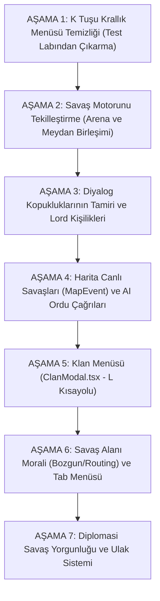

# ⚔️ Sancak-ı Kalradya — Kapsamlı Kod Denetimi, Derin Çekirdek Sorunlar ve Stratejik Eylem Planı

> **Tarih:** 29 Ekim 2026  
> **Kapsam:** Aktif kod tabanı (`src/App.tsx`, `src/game/`, `src/components/`) satır satır denetlenmiş; eski `.md` arşivlerindeki çelişkiler elenmiş ve hem **yüzeydeki sistemik/arayüz hataları** hem de **oyunun can damarı olan çekirdek döngü (core gameplay loop) açıkları** ortaya konmuştur.

---

## 🧭 ÖZET: OYUNUMUZUN ASIL TIKANIKLIĞI NEDİR?

Projemiz sıfırdan yazılmış 3B grafik motoru, fizik/IK iskeleti, 4 yönlü yönlü dövüş, usulî harita ve derin veri modelleriyle **teknik açıdan çok güçlü bir altyapıya** sahiptir.  
Ancak bir "Mount & Blade / Bannerlord" oyunu olarak oynandığında oyuncunun hissettiği temel eksiklikler iki ana katmana ayrılmaktadır:

1. **Katman 1 (Çekirdek Oynanış ve Motor Sorunları):** Savaş motorunun iki ayrı dosyaya bölünmüş olması (`CharacterArenaView` vs `BattlefieldView`), AI lordların oyuncuyu sefere çağırmaması (tek taraflı ordu), askerlerin acemiden elit şövalyeye terfi zincirindeki kopukluklar ve haydut inlerinin yokluğu.
2. **Katman 2 (Sistemik ve Arayüz/Diplomasi Sorunları):** `K` tuşunun oyun içi krallık menüsü yerine bir yazılımcı test laboratuvarı olması, diyalogdaki ölü butonlar, sursuz kuşatma taarruzları, `L` Klan menüsünün hiç yazılmamış olması ve haritada iki lordun canlı savaşamaması.

---

## BÖLÜM 1: DERİN ÇEKİRDEK VE MOTOR BULGULARI (Can Damarı Sorunlar)

### 1.1. İki Ayrı Savaş Motoru ve Çift Başlılık (En Büyük Kod Karmaşası)
* **Kod Kanıtı:** 
  - [`src/components/CharacterArenaView.tsx`](../src/components/CharacterArenaView.tsx) (3.173 satır — Şehir Arenası ve Karakter Test Sahnesi)
  - [`src/components/BattlefieldView.tsx`](../src/components/BattlefieldView.tsx) (3.362 satır — Sefer Haritası Meydan Muharebesi)
* **Bulgu:**
  - Projede aynı temel işi (3B asker dövüşü) yapan **iki farklı devasa dosya (~6.500 satır)** yaşamaktadır.
  - Şehirde arenaya girildiğinde (`viewMode === 'character_arena'`), eski arcade dövüş mekanikleri, ekranda `⚔️ Müttefik Leşi: ...` gibi emojili hasar bildirimleri ve ilkel bir bot yapay zekâsı çalışmaktadır.
  - Haritada bir lordla savaşa girildiğinde ise (`BattlefieldView`), Order of Battle konuşlanması, 4 formasyon, F1–F4 bölük emirleri ve taktiksel hareketler devreye girmektedir.
* **Etki:** Bir savaş motoruna yapılan iyileştirme öbürüne geçmemektedir. Oyuncu şehir arenasına girdiğinde başka, ovada savaşa girdiğinde bambaşka bir oyun oynamaktadır.
* **Gereken Çözüm:** Savaş motorunun **tek bir çekirdeğe (`BattlefieldView`)** indirilmesi; şehir arenasının da bu çekirdeğin "Arena / Turnuva" modu olarak aynı kurallarla çalıştırılması.

---

### 1.2. Yapay Zekânın (AI) Oyuncuyu Asla Sefere Çağırmaması (Tek Taraflı Ordu)
* **Kod Kanıtı:** [`src/game/armySystem.ts`](../src/game/armySystem.ts) ve [`src/game/worldSim.ts`](../src/game/worldSim.ts)
* **Bulgu:**
  - Projedeki Ordu (`Army`) ve Bütünlük (`Cohesion`) sistemi sadece **oyuncunun** nüfuz harcayarak diğer lordları peşine takması için tek taraflı kodlanmıştır.
  - Oyuncu bir krallığın yeminli derebeyi (vasalı) olduğunda, Kral (örneğin Derthert, Caladog veya Rhagaea) büyük bir ordu topladığında oyuncuya asla çağrı gelmemektedir.
* **Bannerlord Gerçekliği:** Bannerlord'da derebeyi olduğunuzda krallık sefer ilan ettiğinde ekranda ordu çağrısı belirir: *"Kral ordusunu topluyor, 3 gün içinde Sargot önündeki orduya katıl!"* Katılmazsanız nüfuz ve ilişki kaybedersiniz; katılırsanız yüzlerce askerlik devasa orduyla kaleleri kuşatmaya gidersiniz.
* **Etki:** Krallık içinde bir asker veya vasal gibi hissetmek imkânsızdır; dünya oyuncunun etrafında dönen cansız bir vitrin gibi kalmaktadır.

---

### 1.3. Asker Gelişimi ve Terfi Zincirinin Savaş Alanıyla Bağlantısı
* **Kod Kanıtı:** [`src/game/bannerlordFoundation.ts`](../src/game/bannerlordFoundation.ts) (`TROOP_TREES`), [`src/components/BattleLootModal.tsx`](../src/components/BattleLootModal.tsx) ve [`src/game/lootTransaction.ts`](../src/game/lootTransaction.ts)
* **Bulgu:**
  - Mount & Blade serisinin en büyük zevki; köylerden toplanan acemi çapulcuların meydan savaşlarında hayatta kaldıkça tecrübe kazanıp adım adım rütbe atlamasıdır (`Tier 1 Köylü -> Tier 2 -> Tier 3 -> Tier 5 Elit Süvari`).
  - Kod tabanında kültür birlik ağaçları (`TROOP_TREES`) tanımlanmış olsa da, meydan savaşında öldürülen düşmanlardan kazanılan asker XP'sinin hayatta kalan asker yığınlarına (`troopStacks[].xp`) işlenmesi ve savaş sonu ganimet ekranında terfiye hazır birimlerin parlaması tam entegre bir akışta değildir (ağırlıklı olarak envanterden eşya atma / Discard XP üzerinden beslenmektedir).

---

### 1.4. Haydut İnleri (`Hideouts`) ve Taktiksel Sızma Operasyonlarının Yokluğu
* **Kod Kanıtı:** [`src/game/worldSim.ts`](../src/game/worldSim.ts) ve [`src/game/rules.ts`](../src/game/rules.ts)
* **Bulgu:**
  - Haritada haydutlar yalnızca rastgele oraya buraya kaçışan küçük partilerdir.
  - Bannerlord'un erken ve orta oyununda oyuncunun nam, ganimet ve eşraf ilişkisi kazandığı en önemli mekanik olan **"Haydut Sığınağı / İni (Hideout)"** sistemi kodda hiç yoktur. Gece vakti 8-9 seçkin askerle sığınağa sızma, nöbetçileri oklama ve haydut elebaşıyla düelloya tutuşma sahnesi bulunmamaktadır.

---

## BÖLÜM 2: SİSTEMİK, DİPLOMASİ VE ARAYÜZ BULGULARI

### 2.1. K Tuşu (Krallık Divanı) "Geliştirici Test Laboratuvarı" Karmaşası
* **Kod Kanıtı:** [`src/components/KingdomManagementModal.tsx`](../src/components/KingdomManagementModal.tsx)
* **Bulgu:**
  - Ekran bir oyun içi devlet yönetim ekranından ziyade formülleri denemek için yazılmış bir debug paneli görünümündedir:
    - `"Mimari Çözüm Modu vs Vanilla Bannerlord Modu"` toggle anahtarı (`useImprovedArchitecture`).
    - `"TaleWorlds.CampaignSystem 4 Katmanlı Yazılım Mimarisi"` analiz ve karşılaştırma tablosu (`architecture_matrix`).
    - `"Son Tımarı Devret & Yıkımı Test Et"` debug butonu (`handleSimulateFieflessDestruction`).
    - `"Açık Hava / Yağmurlu / Karlı Zemin"` simülatör butonları.
    - C# decompile referansları (`DefaultDiplomacyModel`, `DeclareWarAction.ApplyInternal()`).
* **Gerçek Bannerlord Karşılığı:**
  - K ekranı 4 temiz ve net bölümdür:
    1. **Diplomasi:** Kiminle savaşta/barışta olduğumuz, haraç miktarları, barış teklif etme, savaş ilanı oylaması.
    2. **Tımar Konseyi:** Fethedilen şehir/kalelerin kime verileceğini lordlar arasında nüfuzla oylama.
    3. **Politikalar:** 21 krallık kanununu oylamaya sunma.
    4. **Klanlar:** Krallıktaki klanların güç, nüfuz ve tımar dağılımını izleme.

---

### 2.2. Diyalog Sistemi Kopuklukları ve Kişiliksizlik
* **Kod Kanıtı 1 (Ölü Buton):** [`src/components/DialogueModal.tsx:327`](../src/components/DialogueModal.tsx#L327) ve [`src/App.tsx:2415`](../src/App.tsx#L2415)
  - `DialogueModal` içinde `"Siyasi divan müzakeresine geçelim"` seçeneği vardır ve `onOpenDiplomacyCouncil?.(lord)` fonksiyonunu tetikler.
  - Fakat `App.tsx` içinde `DialogueModal` render edilirken bu prop **verilmemiştir**. Oyuncu tıkladığında ekran tepki vermez, hiçbir şey açılmaz.
* **Kod Kanıtı 2 (Kişiliksiz Replikler):** [`src/game/dialogue.ts`](../src/game/dialogue.ts)
  - 40 lordun tamamı tek tip şablon cümleleri konuşmaktadır. Lordların kişilik özellikleri (`personality: Honorable, Cruel, Generous, Daring, Calm vb.`) konuşmalara bağlanmamıştır. Zalim bir haydut derebeyi ile onurlu bir kral aynı sözleri söylemektedir.
* **Kod Kanıtı 3 (Durumsallık Eksikliği):**
  - Lordun haritadaki anlık durumu diyalogda yoktur (ordusu açken, savaştan yeni kaçmışken, esir taşırken veya kuşatmadayken özel karşılama replikleri bulunmamaktadır).
* **Kod Kanıtı 4 (Evlilik ve Aile Ağacı Yalnızca Ansiklopedi Dekoru):** [`src/game/familyTree.ts`](../src/game/familyTree.ts)
  - `familyTree.ts` yalnızca Ansiklopedide (`N`) kahramanların altında statik akrabalık bağları türetmek için çalışır. Gerçek oynanışta leydiyle 2 aşamalı ikna süreci, çeyiz pazarlığı, düğün, eşin birliğe katılması, 37 günlük hamilelik ve çocuk doğumu döngüsü yoktur.

---

### 2.3. Harita Üzerinde Canlı Lord Savaşlarının (`MapEvent`) Olmaması
* **Kod Kanıtı:** [`src/game/worldSim.ts`](../src/game/worldSim.ts) ve [`src/components/WorldCanvas.tsx`](../src/components/WorldCanvas.tsx)
* **Bulgu:**
  - Haritada iki düşman lord karşılaştığında veya kuşatmadaki bir kaleye kurtarma ordusu geldiğinde **canlı bir harita savaşı (`MapEvent`)** başlamaz.
  - `worldSim.ts` arkada sadece matematiksel mesafe kontrolü yaparak bir tarafı kaçırır (`FLEE`). Haritada kılıç çarpışması göstergesi çıkmaz ve iki ordunun mevcudu zamanla kademeli erimez.
  - Oyuncu haritada savaşan iki birliğin yanına gidip **"Dost birliğe yardıma katıl"** diyememektedir.

---

### 2.4. Kuşatma Taarruzunda Sur/Gedik Sahnesinin Olmaması
* **Kod Kanıtı:** [`src/App.tsx:1648`](../src/App.tsx#L1648) `handleStartSiegeBattle`
* **Bulgu:**
  - Kuşatma kampı ekranında (`SiegeEncounterModal.tsx`) "Surlara Taarruz Et" butonuna basıldığında `handleStartSiegeBattle` doğrudan `setSubMode('battle')` çağırarak standart açık alan meydan savaşını açmaktadır.
  - Gerçekte sur, gedik, koçbaşıyla kapı kırma veya surlara merdiven dayama 3B sahnesi yoktur. Kaleye taarruz ederken çayırlıkta ızgara savaşı yapılmaktadır.

---

### 2.5. Klan Menüsünün (`ClanModal.tsx` — `L` Tuşu) Hiç Olmaması
* **Kod Kanıtı:** [`src/components/`](../src/components/) dizin listesi
* **Bulgu:**
  - HUD sol altında `L Klan` butonu yer almasına rağmen `src/components/` klasöründe `ClanModal.tsx` bileşeni **yoktur**.
  - Oyuncunun kendi klan üyelerini, yoldaşlarını (İaşeci, Cerrah, İzci, Mühendis atamaları), kervanlarını, atölyelerini ve tımarlarını topluca yönettiği bir merkez ekran bulunmamaktadır.

---

### 2.6. Savaş Meydanı Moral ve Bozgun (`Routing`) Eksikliği
* **Kod Kanıtı:** [`src/components/BattlefieldView.tsx`](../src/components/BattlefieldView.tsx)
* **Bulgu:**
  - Savaş motorunda moral (`morale`) veya bozgun (`routing`) mantığı yoktur.
  - 100 kişilik bir ordudan 95 kişi ölse bile geriye kalan 5 asker paniğe kapılıp kaçmak yerine son adama kadar ölene dek robot gibi savaşır.
  - Savaş esnasında `Tab` tuşuna basıldığında açılan canlı skor tablosu (Ölü / Yaralı / Kaçan dökümü) ve kurallı geri çekilme mekaniği eksiktir.

---

### 2.7. Diplomasi Savaş Yorgunluğu ve Ulak Eksikliği (`Bannerlord.Diplomacy` Kıyaslaması)
* **Kod Kanıtı:** [`references/Bannerlord.Diplomacy`](../references/Bannerlord.Diplomacy)
* **Bulgu:**
  - **Savaş Yorgunluğu (`War Exhaustion`):** Bannerlord ve Diplomacy modunda savaşlar sonsuza kadar sürmez; verilen kayıplar, yağmalanan köyler ve düşen kaleler her iki tarafta yorgunluk biriktirir (%0–%100) ve %100'e yaklaşan taraf barış istemek zorunda kalır. Bizde savaşlar sadece gün sayısına ve rastgele zara göre bitmektedir.
  - **Ulak (`Messenger`) Sistemi:** Başka bir krallıkla müzakere etmek için haritanın öbür ucuna günlerce at sürmek zorunludur; ulak gönderip uzaktan görüşme başlatılamamaktadır.

---

## BÖLÜM 3: STRATEJİK YOL HARİTASI VE EYLEM PLANI

Bu eksiklikler arasında en doğru ve hatasız ilerleme sırası; **önce göz tırmalayan yabancı cisimleri ve çift başlı motor karmaşasını temizlemek, ardından oyunun temel sefer döngüsünü kurmaktır.**

---

### 1. Aşama: K Tuşu (Krallık Menüsü) Temizliği & Özgün Bannerlord Düzeni — ✅ TAMAMLANDI
* **Durum:** Tamamlandı & Chromium E2E ile Doğrulandı (`tools/e2e/kingdom-check.mjs`).
* **Yapılanlar:**
  - [`KingdomManagementModal.tsx`](../src/components/KingdomManagementModal.tsx) içindeki test artıkları (`architecture_matrix`, yapay hava butonları, test panelleri) tamamen temizlendi.
  - 4 otantik Bannerlord sekmesi kuruldu: **1-Diplomasi (Savaş/Barış), 2-Tımarlar (Kale/Şehir/Köy Dağıtımı), 3-Politikalar (Feodal Kanunlar & Oy Verme), 4-Klanlar Listesi.**

### 2. Aşama: Savaş Motorunu Tekilleştirme (Arena Dövüşü + Meydan Taktik Aklı) — ✅ TAMAMLANDI
* **Durum:** Tamamlandı & Chromium E2E ile Doğrulandı (`tools/e2e/battle-check.mjs`).
* **Kullanıcı Direktifi:** Bozuk `createWarriorModel` ve `animateWarriorRigPose` modelleri terk edildi. `CharacterArenaView.tsx` içindeki tam iskeletli rig, IK, animasyon, 4 yönlü vuruş/blok, zırh/miğfer/kalkan/at sistemleri ve 500v500 ordu havuzu tek omurga yapıldı.
* **Yapılanlar:**
  - `src/components/BattlefieldView.tsx` 3645 satırlık bozuk model kodlarından arındırılarak `CharacterArenaView` motorunu sarmalayan temiz ve yüksek sadakatli tekil savaş motoruna dönüştürüldü.
  - Taktik Katman: 1–4 Bölük Seçimi (Piyade, Okçu, Süvari, Atlı Okçu), F1–F6 Taktiksel Emir Kartları (Konum Tut, Takip Et, Hücum, İlerle, Geri Çekil), F3 Dizilişleri (Çizgi, Kalkan Duvarı, Dağınık, Kare, Kama, Kolon) eklendi.
  - Canlı Savaş HUD'ı: Üst güç dengesi oran çubuğu, anlık Bannerlord Kill Feed, emir haykırma bildirimleri ve Sefer Haritası zayiat/zafer paneli entegre edildi.
  - Kuşatma Geliştirmesi: Sur üstü okçuları (y=5.4m parapet), koçbaşı kapı yıkımı, kuşatma kuleleri ve mancınıklar güçlendirildi.

### 3. Aşama: Diyalog Kopukluklarının Tamiri ve Lord Kişilikleri
* **Neden:** Harita üzerinde oyuncunun en sık yaptığı eylem lordlarla konuşmaktır.
* **Nasıl Yapılacak?**
  - [`App.tsx:2415`](../src/App.tsx#L2415) içine `onOpenDiplomacyCouncil` prop'u bağlanarak ölü buton tamir edilecek.
  - [`dialogue.ts`](../src/game/dialogue.ts) içine 5 kişilik arketipi (*Onurlu, Zalim, Kurnaz, Cüretkar, Sakin*) ve durumsal konuşmalar (*ordusu açken, kuşatmadayken, esir taşırken*) eklenecek.

### 4. Aşama: Harita Canlı Savaşları (`MapEvent`) ve AI Ordu Çağrıları
* **Neden:** Haritanın yaşayan bir dünya olması için lordların gerçekten savaşması ve oyuncunun bu savaşlara katılabilmesi şarttır.
* **Nasıl Yapılacak?**
  - [`worldSim.ts`](../src/game/worldSim.ts) içine `MapEvent` eklenecek; haritada çarpışan lordların üzerinde çapraz kılıç belirecek, askerleri kademeli eriyecek, oyuncu tıklayıp yardıma girebilecek.
  - AI hükümdarlar ordu kurduğunda oyuncuya harita bildirimi gelecek (*"Kral ordusunu topluyor, sefere katıl"*).

### 5. Aşama: Klan Menüsü (`ClanModal.tsx` — `L` Kısayolu)
* **Neden:** Oyuncu krallıktan önce kendi klanını yönetir.
* **Nasıl Yapılacak?**
  - `src/components/ClanModal.tsx` oluşturulacak (Üyeler, Partiler/Kervanlar, Tımarlar, Gelir/Gider sekmeleriyle).

### 6. Aşama: Savaş Alanı Morali (Bozgun/Routing) ve Tab Menüsü
* **Neden:** Muharebelerin inandırıcılığı için ağır kayıp veren birliğin panikle kaçması şarttır.
* **Nasıl Yapılacak?**
  - `BattlefieldView.tsx` içine takım morali eklenecek, zayiat veren birimler harita sınırına kaçacak; `Tab` ile canlı skor ve çekilme menüsü sunulacak.

### 7. Aşama: Diplomasi Savaş Yorgunluğu ve Ulak Sistemi
* **Neden:** Savaş ve barış döngüsünü mantıklı bir feodal diplomasiye bağlamak için.
* **Nasıl Yapılacak?**
  - `Bannerlord.Diplomacy` modundan esinlenerek savaş yorgunluğu biriktirme (%0–%100) ve ulak gönderme mekaniği entegre edilecek.

---

## 8. Kalradya Tek ve Birleşik 3B Muharebe Motoru (Tamamlandı)
- **Eski Durum**: Sefer haritası ile Arena arasında iki ayrı motor (eski `BattlefieldView` ve `CharacterArenaView`) vardı. Eski motorda prosedürel kutular (`createWarriorModel`), animasyonsuz eklemler ve bozuk kamera bulunuyordu.
- **Birleştirme**: `BattlefieldView.tsx`, `CharacterArenaView` üzerinden tek merkez haline getirildi.
- **Karakter İskeletleri & Zırhlar**: Tüm küpler kaldırıldı. Muharebedeki tüm piyade, okçu ve süvariler tam rig iskeletli (`CharacterRig`), zırhlı (`PLATE`, `CHAINMAIL`, `LEATHER`), miğferli (`SPANGENHELM`, `IMPERIAL_VISOR`, `KETTLE_HAT`) ve silahlı modellerle donatıldı.
- **Gerçek Karşılaşma & Lord**: Sefer haritasındaki gerçek lord (örn. Lord Garios) kendi yüz morfolojisi (`getLordDNA`), özel zırhı, zırhlı savaş atı ve tepesinde yüzen 3B altın taç rozetiyle (`👑 Lord Garios`) ordusunun başında fiziksel olarak konuşlandırıldı.
- **Gündüz Atmosferi**: Zifiri karanlık zindan sisi yerine Kalradya açık mavi gökyüzü, 260m berrak mesafe sisi ve geniş yeşil ova arazisi entegre edildi.
- **Kamera & Kontrol**: 3. şahıs omuz üstü dinamik savaşçı kamerası ilk kareden itibaren oyuncunun arkasında aktif; fare hareketi anında yönü çevirir; tıklama zorunluluğu kaldırıldı.
- **HUD & Test Panelleri**: Sefer haritası savaşlarında geliştirici test panelleri, 360 manken düğmeleri ve 500v500 ön yükleme modalları tamamen gizlendi; temiz Bannerlord taktik arayüzü sunuldu.
- **Doğrulama**: `tools/e2e/battle-check.mjs` ve `npm run verify:fast` testleri %100 başarıyla geçti.

