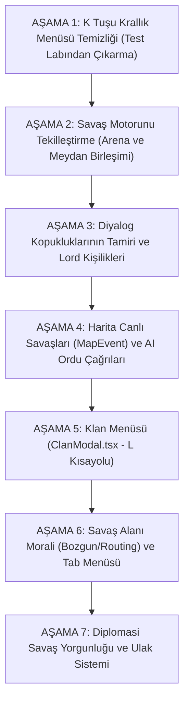

# ⚔️ Sancak-ı Kalradya — Kapsamlı Muharebe, Diyalog ve Diplomasi Denetimi & Eylem Planı

> **Tarih:** 31 Ekim 2026  
> **Kapsam:** Kullanıcı tarafından bildirilen tüm muharebe sahası, HUD, diyalog, diplomasi ve yapay zeka hatalarının derinlemesine kök neden analizi, Bannerlord/Warband referans karşılaştırması ve adım adım çözüm planı.  
> **Temel İlke (Altın Kural):** Gerçek Mount & Blade II: Bannerlord sistemlerine, formüllerine, ekran düzenlerine ve görsel hiyerarşisine tam sadakat. Ezbere/uydurma mekanik yok.

---

## 🧭 İÇİNDEKİLER VE HATA MATRİSİ

Aşağıdaki tablo, kullanıcı tarafından ekran görüntüleriyle ve metinle iletilen **14 kritik konunun** mevcut durumunu ve kök neden dosya/satır haritasını özetler:

| # | Bildirilen Hata / Talep | Etkilenen Dosyalar | Kök Neden / Satır | Bannerlord Karşılığı |
|---|---|---|---|---|
| **1** | **Paralı asker olunca ülkenin düşmanlarıyla düşman olmama** | `App.tsx`, `encounter.ts`, `dialogue.ts`, `rules.ts` | `App.tsx:2439` (diyalogda `onChangeAllegiance` eksik), `encounter.ts:82` (krallık savaşları kontrol edilmiyor) | Paralı asker veya vasal olunduğunda işverenin savaştığı tüm krallıklar anında oyuncuya düşman olur (`FactionPair.cs`). |
| **2** | **Bazı okların havada takılı kalması** | `CharacterArenaView.tsx` | `CharacterArenaView.tsx:3296` ve `3498` (`inFlight=false` olan okların sahneden silinmemesi ve lifetime döngüsünden atlanması) | Hedefe veya yere çarpan oklar belirli süre sonra despawn olur, havada asılı kalmaz (`battleCombat.ts`). |
| **3** | **Attan inince atın yok olması** | `CharacterArenaView.tsx` | `CharacterArenaView.tsx:625` (`horseRig.root.visible = false;`) | Binici attan indiğinde at sahnede oyuncunun yanında bekler, rölantide nefes alır ve tekrar binilebilir. |
| **4** | **Ölünce karakterin hareket edebilmesi** | `CharacterArenaView.tsx` | `CharacterArenaView.tsx:2431` (WASD hareket bloğunda `playerHpRef.current > 0` kontrolü yok) | Komutan düştüğünde kontrol kilitlenir, ceset yerde kalır, kamera serbest/yörünge moduna geçer. |
| **5** | **Yenilen lordla haritada anında tekrar diyalog / sonsuz savaş** | `WorldCanvas.tsx`, `lootTransaction.ts`, `App.tsx` | `lootTransaction.ts:309` (`l.x, l.z` güncelleniyor ancak `WorldCanvas` canlı rotası `lordLiveRoutes` güncellenmiyor; temas bekleme süresi yok) | Yenilen lord kaçar veya esir düşer; serbest kalan lorda en az 60 sn temas koruması (grace cooldown) verilir. |
| **6** | **Muharebede "Sol Tık Saldır / Sağ Tık Blok" yazılarının olması** | `CharacterArenaView.tsx` | `CharacterArenaView.tsx:4685-4695`, `4520-4522` | Bannerlord muharebe ekranında fare tıklama eğitim yazıları bulunmaz; yalnızca 4 yönlü savaş nişangâhı yer alır. |
| **7** | **Tüm askerler ölünce maçın bitmemesi & cesede saldırma** | `CharacterArenaView.tsx` | `CharacterArenaView.tsx:2867` (`nearestAlly` null olunca `nearestAlly!.agent.x` fırlatması ve simülasyonun çökmesi) | Tüm müttefikler ve komutan düştüğünde savaş YENİLGİ ile sonuçlanır, düşmanlar tezahürat yapar. |
| **8** | **Meydan savaşında birbirine çok yakın başlama** | `CharacterArenaView.tsx` | `CharacterArenaView.tsx:189` (`ARENA_RADIUS = 17`, müttefik `z=13.5`, düşman `z=-18.0` — mesafe 31.5m!) | Bannerlord meydan savaşlarında iki ordu 140m–180m mesafeden başlar; konuşlanma ve manevra fırsatı tanınır. |
| **9** | **Meydan savaşının sadece düz yeşillikten ibaret olması** | `CharacterArenaView.tsx` | `CharacterArenaView.tsx:1504-1520` (düz yeşil `THREE.PlaneGeometry(380, 380)`) | Yükseklik dalgalanmaları (tepeler/vadiler), ağaçlar, kayalar, çalılar ve atmosferik sis olmalıdır. |
| **10** | **Ölüm ses efektlerinin olmaması** | `sound.ts`, `CharacterArenaView.tsx` | `CharacterArenaView.tsx:3416`, `3453` (`sound.ts` içinde `playDeathSound` çağrılmıyor) | Askerler ve komutan öldüğünde acı feryadı, ölüm iniltisi veya yere düşme çarpma sesi çıkar. |
| **11** | **Oyuncu ölünce askerlerin cesedi takip etmesi** | `CharacterArenaView.tsx` | `CharacterArenaView.tsx:2700-2720` (`FOLLOW_ME` emrindeki birimler ölü oyuncunun koordinatına koşuyor) | Komutan düşünce çavuş/kaptan yapay zekası devreye girer; ordu serbest hücum (`CHARGE`) moduna geçer. |
| **12** | **Ekrandaki gereksiz butonlar & güç dengesi çubuğunun konumu** | `CharacterArenaView.tsx` | `CharacterArenaView.tsx:3657-3730` (sol üst butonlar), `4215` (ortadaki TAB butonu), `3760-3810` (alttaki kalıcı emir şeridi) | Güç çubuğu tam üst ortadadır (`top: 8px`). Sol üst butonlar ve ortadaki TAB butonu kalkar. Alttaki şerit F tuşlarıyla açılır. |
| **13** | **Diyalogdaki roman/anlatım ifadeleri** | `dialogue.ts` | `dialogue.ts:217-223` (`relationTone`), `620-626` (parantez içi durum tasvirleri) | Bannerlord diyalogları doğrudan lordun ağzından birinci şahıs hitaptır; 3. şahıs tasvir cümleleri bulunmaz. |
| **14** | **Otantik Zafer & Yenilgi Ekranı akışı** | `CharacterArenaView.tsx`, `App.tsx` | Küçük web popup modalı (`CharacterArenaView.tsx:4435-4485`) | Üstte altın sarısı "ZAFER" / kan kırmızısı "YENİLGİ" kurdelesi, serbest kamera, asker sevinçleri ve `[TAB]` geçişi. |

---

## 🔍 BÖLÜM 1: DERİN KÖK NEDEN ANALİZİ VE BANNERLORD MİMARİSİ

### 1. Paralı Askerlik & Krallık Diplomasisi (Faction War Inheritance)

#### Sorunun Teşhisi:
Kullanıcı bir krallığa (örneğin Vlandiya) paralı asker olarak katıldığında, Vlandiya'nın savaşta olduğu devletler (örneğin Batanya veya Sturgiya) oyuncuya düşman olmuyor; haritada yanlarından geçerken saldırmıyorlar veya diyalog barışçıl kalıyor.

#### Kök Neden:
1. **Diyalog Modalında Callback Eksikliği (`App.tsx:2439`):**  
   `DialogueModal.tsx` içinde `SET_ALLEGIANCE` eylemi (satır 320: `onChangeAllegiance?.(action.faction, action.role)`) tanımlıdır. Fakat `App.tsx` satır 2439'daki `<DialogueModal>` bileşenine `onChangeAllegiance` prop'u **hiç geçirilmemiştir**! Bu nedenle diyalog üzerinden soyluyla konuşup "Sözleşmeyi kabul ediyorum" denildiğinde `applyPlayerAllegianceChange` asla tetiklenmemektedir!
2. **Düşmanlık Kontrolünün Statik Olması (`encounter.ts:82`):**  
   ```typescript
   export function isHostileToPlayer(lord: LordAgent): boolean {
     return Boolean(lord.isAtWarWithPlayer || lord.faction === 'bandits');
   }
   ```
   Bu fonksiyon yalnızca bireysel lordun `isAtWarWithPlayer` bayrağına bakmaktadır. Oyuncunun `campaign.playerFaction` ve `campaign.allegianceRole` değerlerine bakıp, o krallığın aktif savaşta olduğu tüm fraksiyonları dinamik olarak düşman saymamaktadır.

#### Bannerlord Referansı (`references/Bannerlord.Diplomacy/src/Bannerlord.Diplomacy`):
Bannerlord'da `Clan.IsUnderMercenaryService` aktifleştiğinde, klanın krallıkla olan ilişkisi `FactionPair` üzerinden senkronize edilir. Krallık hangi krallıkla `StanceLink.IsAtWar` durumundaysa, paralı klan da aynı krallıklarla anında savaş durumuna geçer.

#### Çözüm Planı:
1. `App.tsx` içindeki `<DialogueModal>` bileşenine `onChangeAllegiance` fonksiyonunu bağlamak.
2. `isHostileToPlayer(lord: LordAgent, campaign?: CampaignState)` fonksiyonunu güncellemek: Eğer oyuncu bir krallığın paralı askeri (`MERCENARY`) veya vasalı (`VASSAL`) ise ve o krallık lordun krallığı ile savaşta ise (`world.wars`), lordu otomatik olarak oyuncuya düşman kabul etmek.
3. Sefer döngüsünde (`worldSim.ts`) savaş ilanı veya barış yapıldığında oyuncunun bağlı olduğu krallığın savaş durumunu otomatik senkronize etmek.

---

### 2. Havada Asılı Kalan Oklar (Stuck Projectile Bug)

#### Sorunun Teşhisi:
Muharebe esnasında fırlatılan bazı oklar havada asılı kalmakta ve sonsuza kadar yok olmamaktadır.

#### Kök Neden:
`CharacterArenaView.tsx` içindeki ok güncelleme döngüsünde (`lines 3294-3503`):
```typescript
const arrows = flyingArrowsRef.current;
for (const arrow of arrows) {
  if (!arrow.inFlight) continue; // <-- HATA 1: inFlight false ise döngü atlanıyor!
  ...
  // Vuruş anında (kukla, kalkan, bot, asker vs.):
  arrow.inFlight = false;
  continue; // <-- Sahnede o yükseklikte bırakılıyor!
  ...
  // Ömür kontrolü (satır 3498):
  if (Date.now() - arrow.spawnTime > ARROW_LIFETIME) {
    arrow.inFlight = false;
    scene.remove(arrow.mesh); // <-- ASLA ÇAĞRILMIYOR çünkü yukarıdaki if (!arrow.inFlight) continue atlatıyor!
  }
}
```
Bir ok bir askere, kalkana veya hedefe çarptığında `arrow.inFlight = false` yapılıyor ve mesh sahnede o yükseklikte (y = 1.2m vs.) bırakılıyor. Bir sonraki karede `if (!arrow.inFlight) continue;` çalıştığı için ok mesh'i ne sahneden siliniyor (`scene.remove`) ne de diziden temizleniyor! Ok sonsuza kadar havada asılı kalıyor.

#### Çözüm Planı:
1. Ok bir hedefe çarptığında ya hedefe/zemine saplanmalı ya da belirli bir süre (örneğin 3 saniye) sonra sahneden tamamen kaldırılmalıdır.
2. `flyingArrowsRef.current` dizisi periyodik olarak temizlenmeli (`scene.remove(arrow.mesh)`), havada asılı kalan mesh'ler sahneden sökülmelidir.

---

### 3. Attan İnince Atın Yok Olması (Dismount Horse Deletion)

#### Sorunun Teşhisi:
Oyuncu veya bot attan indiğinde (`M` tuşu veya `isMounted = false`), at haritada kalmak yerine anında yok olmaktadır.

#### Kök Neden:
`CharacterArenaView.tsx` satır 624-629:
```typescript
} else {
  horseRig.root.visible = false; // <-- AT BURADA AÇIKÇA GİZLENİYOR!
  scene.add(playerRig.root);
  playerRig.root.position.copy(playerPosRef.current);
  playerRig.root.rotation.y = playerYawRef.current;
}
```
Görüldüğü üzere kod attan inilince `horseRig.root.visible = false` yaparak atı doğrudan yok etmektedir!

#### Bannerlord Referansı:
Bannerlord'da binici attan indiğinde:
- Binici atın sol tarafına adım atar.
- At sahnede görünür kalır (`visible = true`).
- At bağımsız bir aktör olarak bekler, hafif baş/kuyruk rölanti animasyonuna geçer.
- Oyuncu atın yanına yaklaşıp tekrar binebilir.

#### Çözüm Planı:
1. `horseRig.root.visible = false;` satırını kaldırmak.
2. Atı oyuncunun indiği koordinatta bağımsız olarak sahnede bırakmak (`scene.add(horseRig.root)`).
3. Oyuncunun koordinatını atın yanına kaydırmak (`playerPos.x += 0.8`).
4. Atı rölanti (idle) durumuna almak.

---

### 4. Ölüyken Hareket Edebilme (Player Movement While Dead)

#### Sorunun Teşhisi:
Oyuncu öldüğünde (canı 0 olduğunda ve yere düştüğünde) WASD tuşlarına basıldığında ceset yerde kayarak hareket etmektedir.

#### Kök Neden:
`CharacterArenaView.tsx` satır 2431:
```typescript
if (mode === 'PLAYABLE' && anim) {
  const localMove = new THREE.Vector3();
  if (keys['KeyW'] || keys['ArrowUp']) localMove.z += 1;
  ...
  playerPosRef.current.addScaledVector(worldMove, moveSpeed * delta);
```
Oyuncunun hareket kodunda **`playerHpRef.current > 0` kontrolü tamamen unutulmuştur!** Karakter animasyonu `anim.fall()` ile yere yıkılsa bile, klavye girdisi `playerPosRef.current` vektörünü güncellemeye devam etmektedir.

#### Çözüm Planı:
1. Hareket bloğunun başına `if (playerHpRef.current <= 0) return;` kontrolü eklemek.
2. Karakter öldüğünde yürüme animasyonunu sıfırlamak (`anim.setMove(0, 0)`).

---

### 5. Yenilen Lordla Sonsuz Savaş / Diyalog Döngüsü (Infinite Encounter Loop)

#### Sorunun Teşhisi:
Savaşta yendiğimiz lord, savaş bitip sefer haritasına dönüldüğünde hemen tekrar diyalog başlatmakta ve oyuncuyu aynı kişiyle tekrar tekrar savaşmaya zorlamaktadır.

#### Kök Neden:
1. **Canlı Harita Rotasının Güncellenmemesi (`AGENTS.md` Kural 2 İhlali):**  
   Savaş kazanıldığında `lootTransaction.ts:309` düşman lordun `campaign.lords` kaydındaki koordinatlarını (`l.x, l.z`) günceller. Ancak `AGENTS.md` 2. kuralı açıkça belirtir:  
   *"Canlı lord konumunu harita rotası tutar... oyun sırasında otorite `WorldCanvas` içindeki `lordLiveRoutes` ve `lordPositionsRef`tir. Yalnızca `campaign` alanını değiştirmek haritayı taşımaz."*  
   Canlı rota güncellenmediği için lord haritada tam oyuncunun üzerinde (mesafe = 0) kalmaya devam eder!
2. **Temas Bekleme Süresi (Encounter Grace Cooldown) Yokluğu:**  
   `WorldCanvas.tsx:2596` içinde oyuncu ile düşman arasındaki mesafe kontrol edilirken, lordun savaştan yeni çıkıp çıkmadığına dair bir cooldown kontrolü yoktur. Sefer haritası açılır açılmaz lord oyuncunun dibinde olduğu için `checkHostileMapInterception` saniyesinde tekrar tetiklenir.

#### Bannerlord Referansı (`references/Bannerlord.Diplomacy/CooldownManager.cs`):
Bannerlord'da savaşı kaybeden lord ya esir alınır ya da ordusu dağılmış olarak en yakın dost kaleye doğru yüksek hızla kaçar (`fleeing`). Karşılaşma sonrası taraflar arasında en az 48 saatlik temas koruması bulunur.

#### Çözüm Planı:
1. Muharebe kazanıldığında mağlup lordun canlı harita konumunu (`lordPositionsRef` ve `lordLiveRoutes`) oyuncudan en az 35-40 birim uzağa taşımak.
2. Mağlup lorda en az 60 saniyelik bir `encounterCooldownSec` tanımlamak; bu süre boyunca oyuncuyu yakalamasını engellemek.
3. Eğer lord esir alındıysa haritadan geçici olarak kaldırılmasını (`characterState = 'CAPTIVE'`) garantiye almak.

---

### 6. Muharebe Meydanındaki Fare Kılavuz Yazıları (Combat Key Prompt HUD Clutter)

#### Sorunun Teşhisi:
Kullanıcının 1. ekran görüntüsünde kırmızıyla işaretlediği gibi, ekranın tam ortasında `[Sol Tık] Saldır • [Sağ Tık] Blok • [E] Tekme • [Sağ Tık + Sol Tık] Kalkan Darbesi` ve yay nişanında `Sol Tık: Ger & Nişan Al` gibi gereksiz yazılar durmaktadır.

#### Kök Neden:
`CharacterArenaView.tsx` satır 4685-4695 ve satır 4520-4522'de hardcoded olarak render edilen bilgilendirme kutuları.

#### Bannerlord Referansı:
Bannerlord veya Warband'de muharebe esnasında ekranda fare tuşlarını anlatan yazılar bulunmaz. Oyuncunun yön tayini için yalnızca 4 yönlü minimalist nişangâh (reticle) bulunur.

#### Çözüm Planı:
Meydan ve kuşatma savaşlarında (`isFieldOrSiege`) bu kılavuz kutucuklarını render etmemek.

---

### 7. Tüm Askerler Ölünce Savaşın Bitmemesi & Cesede Saldırma (Battlefield Wipe Stall)

#### Sorunun Teşhisi:
Oyuncu öldükten sonra düşman askerleri tüm müttefiklerimizi öldürse bile savaş bitmemekte; düşmanlar ölü komutanın cesedinin üstüne gelmeye devam etmekte ve maç sonlanmamaktadır.

#### Kök Neden:
`CharacterArenaView.tsx` satır 2863-2868:
```typescript
const nearestAlly = grid.findNearest(enemy.x, enemy.z, 60, (c) => c.team === 'ALLY' && c.alive && !c.routed);
const distToPlayer = Math.hypot(playerPosRef.current.x - enemy.x, playerPosRef.current.z - enemy.z);
const targetPlayer = playerHpRef.current > 0 && (!nearestAlly || distToPlayer < 4.2);

const tx = targetPlayer ? playerPosRef.current.x : nearestAlly!.agent.x; // <-- KRİTİK ÇÖKME!
const tz = targetPlayer ? playerPosRef.current.z : nearestAlly!.agent.z; // <-- KRİTİK ÇÖKME!
```
1. **JavaScript TypeError Runtime Crash:**  
   Oyuncu öldüğünde (`playerHpRef.current <= 0`) `targetPlayer` **`false`** olur.  
   Tüm müttefikler de öldüğünde `nearestAlly` **`null`** olur.  
   Bu durumda kod `nearestAlly!.agent.x` satırını çalıştırmayı dener! `nearestAlly` null olduğu için tarayıcı `Cannot read properties of null (reading 'agent')` hatası fırlatır!  
   Bu istisna `requestAnimationFrame` döngüsünü tamamen çökertir (kırar). Döngü çöktüğü için satır 3112'deki yenilgi kontrolü (`playerHp <= 0 && curAllies === 0`) **asla çalışamaz!** Oyun donar ve maç bitmez.
2. **Yapay Zekanın Cesede Yönelmesi:**  
   Düşman birimleri hayatta olan bir hedef bulamadığında varsayılan olarak oyuncunun son koordinatına yürümektedir.

#### Çözüm Planı:
1. `nearestAlly` null ve oyuncu ölü olduğunda hiçbir düşmanın hedef aramaması; doğrudan zafer kutlama moduna (`cheer`) geçmesi.
2. `curAllies === 0 && playerHpRef.current <= 0` durumu tespit edildiğinde anında Bannerlord Yenilgi Akışının (`triggerDefeatSequence`) tetiklenmesi.

---

### 8. Meydan Savaşı Başlangıç Mesafesi (Spawn Separation Distance)

#### Sorunun Teşhisi:
Meydan savaşına girildiğinde düşmanla neredeyse burun buruna (30 metre) başlanmaktadır. Taktik yapacak, okçuları dizecek veya formasyon alacak hiçbir mesafe ve zaman kalmamaktadır.

#### Kök Neden:
`CharacterArenaView.tsx` satır 189 ve 1050:
- `ARENA_RADIUS = 17`
- Müttefik spawn: `z = 13.5`
- Düşman spawn: `z = -18.0`
- Toplam başlangıç mesafesi: **31.5 metre!** Süvarinin bu mesafeyi katetmesi sadece 3 saniye sürmektedir!

#### Bannerlord Referansı:
Bannerlord meydan muharebelerinde iki ordunun ana hatları arasındaki mesafe **140 metre ile 180 metre** arasındadır. Oyuncu savaşa başlamadan önce konuşlanma (Order of Battle) yapar; piyadeleri öne çeker, okçuları tepeye yerleştirir.

#### Çözüm Planı:
Meydan ve kuşatma savaşlarında (`isFieldOrSiege`):
1. Müttefik hattını `z = +75` (veya derinliğe göre +85), düşman hattını `z = -75` olarak ayarlamak (toplam mesafe ~150-160 metre).
2. Muharebe harita sınırını (`ARENA_RADIUS`) 180 metreye genişletmek.

---

### 9. Meydan Savaşı Arazisi ve Çevre Geliştirmesi (Procedural Battlefield Terrain)

#### Sorunun Teşhisi:
Meydan savaşı haritası düz, boş yeşil bir dairesel zeminden ibarettir. Ağaç, tepe, kaya veya çevre detayı yoktur.

#### Kök Neden:
`CharacterArenaView.tsx:1504-1520` içinde zemin sadece tek renkli düz bir `THREE.PlaneGeometry(380, 380, 20, 20)` olarak çizilmektedir. Yükseklik değişimi (vertex displacement) veya prosedürel nesneler eklenmemiştir.

#### Bannerlord Referansı:
Bannerlord ve Warband muharebelerinde arazi taktiğin yarısıdır:
- Yüksek tepeler okçulara menzil ve görüş avantajı sağlar.
- Eğimli araziler yukarı doğru hücum eden süvari ve piyadeleri yavaşlatır.
- Ağaçlar ve kayalar süvari hücumlarını kırar ve piyadelere siper sağlar.

#### Çözüm Planı:
1. `PlaneGeometry` vertexlerine hafif tepe/vadi dalgalanması (Perlin/Sinüs tabanlı yükseklik) vermek.
2. Haritanın kenarlarına ve belirli noktalarına low-poly çam/meşe ağaçları, kaya kümeleri ve ahşap çitler yerleştirmek.
3. Birlik hareket fiziğinde zemin yüksekliğini (`getY(x, z)`) hesaba katarak birimlerin tepeye tırmanırken gerçekçi hareket etmesini sağlamak.

---

### 10. Ölüm Ses Efektleri (Death SFX)

#### Sorunun Teşhisi:
Karakterler veya askerler öldüğünde hiçbir ses çıkmamaktadır. Yalnızca kılıç/kalkan çarpma sesi duyulmaktadır.

#### Kök Neden:
`sound.ts` içinde `/sounds/man_yell_01.ogg`, `/sounds/man_yell_04.ogg` ve `/sounds/decap1.ogg` dosyaları bulunmasına rağmen, bir asker veya oyuncu öldüğünde (`CharacterArenaView.tsx:3416`, `3453`) bu sesler çağrılmamaktadır.

#### Çözüm Planı:
1. `sound.ts` içine `playDeathScream()` ve `playPainGrunt()` metotları eklemek (mevcut OGG dosyaları ve WebAudio sentetik acı iniltisi sentezleyicisi ile).
2. Bir asker veya oyuncu öldüğünde bu sesi tetiklemek.

---

### 11. Oyuncu Ölünce Müttefiklerin Takip Etme Hatası (Allied Follow-Me AI Bug)

#### Sorunun Teşhisi:
Oyuncu öldüğünde, müttefik askerler ölü komutanın yerde yatan cesedini takip etmeye çalışmakta; düşmana saldırmak yerine cesedin etrafında dönmektedir.

#### Kök Neden:
Müttefik askerler `FOLLOW_ME` emrindeyken hedef koordinat olarak doğrudan `playerPosRef.current` noktasını almaktadır. Oyuncu öldüğünde (`playerHpRef.current <= 0`), emir otomatik olarak değiştirilmemektedir.

#### Bannerlord Referansı:
Bannerlord'da komutan düştüğünde ("Commander Down!") bir bildirim çıkar, orduya bir moral şoku gelir ve komuta otomatik olarak kıdemli çavuşa/kaptana devredilir. Kaptan yapay zekası derhal serbest hücum (`Charge`) veya savunma hattı emri vererek düşmanla savaşmaya devam eder.

#### Çözüm Planı:
Oyuncu düştüğü an (`playerHpRef.current <= 0`):
1. `formationOrderRef.current = 'CHARGE'` olarak ayarlanacak.
2. Müttefik askerlerin hedefi ölü komutan yerine en yakın canlı düşman birliği olarak güncellenecek.

---

### 12. Güç Dengesi Çubuğu ve Ekrandaki Gereksiz HUD Elemanları

#### Sorunun Teşhisi:
Kullanıcının 1. ekran görüntüsünde işaretlediği öğeler:
1. Sol üst köşedeki `← Sefer Haritası`, `⚔️ İkili Meydan Muharebesi`, `🏇 Savaş Atında` butonları.
2. Ekranın ortasında yüzen `[TAB] Muharebe Skoru & Tabur Morali` butonu.
3. Ekranın altında sürekli açık duran `BÖLÜM: 0: Tümü (8/8) | KOMUT [F]: ...` şeridi.
4. Güç dengesi göstergesinin butonlar yüzünden aşağıda kalması.

#### Bannerlord Referansı:
- **Güç Dengesi Çubuğu:** Ekranın tam üst ortasında, en tepede (`top: 8px`) yer alır. Müttefikler (yeşil/mavi) ve düşmanlar (kırmızı) oranını minimalist bir çubukla gösterir.
- **Sol Üst Butonlar:** Bannerlord muharebesinde sol üstte haritaya kaçış butonları olmaz; savaştan çıkış `Tab` tuşuna basılı tutarak kurallı çekilme ile yapılır.
- **Ortadaki TAB Butonu:** Warband/Bannerlord'da ekranda "TAB'a Bas" diye tıklanabilir buton durmaz; oyuncu doğrudan klavyedeki `Tab` tuşuna basar.
- **Emir Şeridi:** Alttaki emir şeridi ekranda kalıcı olarak durmaz; oyuncu `F1`, `F2`, `F3` tuşlarına bastığında açılır, emir verilince kapanır.

#### Çözüm Planı:
1. Sol üstteki test butonlarını meydan ve kuşatma modunda (`isFieldOrSiege`) tamamen gizlemek.
2. Güç dengesi çubuğunu ekranın en üstüne (`top: 8px`, `left: 50%`, `transform: translateX(-50%)`) sabitlemek.
3. Ortadaki yüzen `[TAB]` butonunu kaldırmak; yalnızca klavyeden `Tab` tuşuna basıldığında açılmasını sağlamak.
4. Alttaki emir şeridini Bannerlord gibi F tuşuna basılınca açılan dinamik popup menü haline getirmek.

---

### 13. Diyalog Ekranındaki Roman/Anlatım Metinleri

#### Sorunun Teşhisi:
Kullanıcının 2. ekran görüntüsünde işaretlediği gibi, diyalog açıldığında:
`"Sana ölçülü bir selam veriyor."`
`"(Kuşatma mevzilerinde, mancınıkların ve koçbaşının başında)"`
gibi üçüncü şahıs roman anlatımları ve parantez içi durum tasvirleri çıkmaktadır.

#### Kök Neden:
`dialogue.ts` satır 217-223:
```typescript
function relationTone(relation: number): string {
  if (relation <= -20) return 'Sana düşmanca, sert bir bakış fırlatıyor.';
  if (relation < 0) return 'Sana soğuk ve mesafeli bir baş selamı veriyor.';
  if (relation === 0) return 'Sana ölçülü bir selam veriyor.'; // <-- EKRANDAKİ METİN!
  if (relation < 20) return 'Sana sıcak bir tebessümle selam veriyor.';
  return 'Sana hürmetle ve dostça selam veriyor.';
}
```
Ve satır 620-626:
```typescript
if (isBesieging) {
  return `(Kuşatma mevzilerinde, mancınıkların ve koçbaşının başında) ${salutation}`;
}
```

#### Bannerlord Referansı:
Bannerlord'da diyaloglar tiyatro sahnesi veya roman gibi üçüncü şahıs anlatıcı içermez. Lord doğrudan oyuncunun gözünün içine bakarak konuşur:
*"Selam yabancı. Ordumun önünü ne cüretle kesersin?"* veya *"Hoş geldin dostum, seninle konuşmak her zaman bir zevk."*

#### Çözüm Planı:
1. `relationTone` fonksiyonunun ürettiği üçüncü şahıs tasvir cümlelerini diyalog metinlerinden tamamen temizlemek.
2. Parantez içi durum tasvirlerini (`(Kuşatma mevzilerinde...)`) kaldırmak; durumu doğrudan lordun kendi konuşma repliğine yedirmek.

---

### 14. Otantik Zafer ve Yenilgi Ekranı Akışı

#### Sorunun Teşhisi:
Savaş bittiğinde ortada açılan basit web modalı Bannerlord hissiyatını vermemekte; savaşın bittiği anlaşılamamaktadır.

#### Bannerlord Referansı:
Bannerlord'da son düşman askeri düştüğünde veya kaçtığında:
1. Üstten altın yaldızlı bir kurdele iner: **"ZAFER"** yazısı ve zafer borusu (`sound.playVictoryFanfare()`).
2. Kalan askerler kılıçlarını havaya kaldırıp zafer naraları atar ("Hurrah!", `sound.playBattleYell()`).
3. Kamera serbest yörünge moduna geçer; oyuncu etrafı izleyebilir.
4. Ekranın altında `[TAB] Sonuçları Gör` bildirimi çıkar.
5. `Tab` tuşuna basıldığında Ganimet & Esir ekranına geçilir.

Yenilgi durumunda ise:
1. Üstten koyu kan kırmızısı bir kurdele iner: **"YENİLGİ"** yazısı ve hazin davul sesi.
2. Düşmanlar zafer nidaları atar.
3. `[TAB] Teslim Ol` bildirimi ile esaret akışına geçilir.

---

## 🛠️ BÖLÜM 2: UYGULAMA VE DOĞRULAMA ADIMLARI

Kullanıcı onayı alındıktan sonra icra edilecek adımlar:

1. **Adım 1: Diyalog ve Diplomasi Düzeltmeleri**
   - `dialogue.ts`: `relationTone` ve parantez içi anlatımları kaldırmak.
   - `App.tsx`: `<DialogueModal>` içine `onChangeAllegiance` bağlamak.
   - `encounter.ts`: `isHostileToPlayer` fonksiyonunu krallık savaşlarıyla dinamik hale getirmek.

2. **Adım 2: Muharebe Alanı HUD ve Kamera Temizliği**
   - `CharacterArenaView.tsx`: Sol üstteki test butonlarını ve ortadaki `[TAB]` butonunu kaldırmak.
   - Güç dengesi göstergesini ekranın en üstüne (`top: 8px`) sabitlemek.
   - Ortadaki `[Sol Tık] Saldır` ve yay nişan kılavuz kutucuklarını kaldırmak.
   - Alttaki kalıcı emir şeridini F tuşlarına basıldığında açılan geçici menü haline getirmek.

3. **Adım 3: Muharebe Başlangıç Mesafesi ve Arazi**
   - Başlangıç mesafesini 31 metreden 150 metreye çıkarmak (`z = ±75`).
   - Meydan arazisine yükseklik dalgalanmaları (tepeler), ağaçlar, kayalar ve çitler eklemek.

4. **Adım 4: Savaş Mekaniği ve Hata Düzeltmeleri**
   - Okların havada asılı kalmasını engellemek; vuruş sonrası ömür ve sahne temizliğini düzeltmek.
   - Attan inildiğinde atın sahnede kalmasını sağlamak (`visible = true`).
   - Oyuncu öldüğünde WASD hareketini engellemek (`playerHp > 0`).
   - `nearestAlly` null olduğunda meydana gelen çökme hatasını düzeltmek; maçın bitmesini sağlamak.
   - Komutan düşünce müttefik birimlerin `CHARGE` moduna geçmesini sağlamak.
   - `sound.ts` içine ölüm seslerini eklemek ve birimler öldüğünde çalmak.

5. **Adım 5: Savaş Sonu Akışı ve Harita Cooldown'u**
   - Otantik Bannerlord Zafer/Yenilgi kurdelesi ve `[TAB]` geçişini uygulamak.
   - Savaştan sonra yenilen lordu canlı haritada (`lordLiveRoutes`) uzağa taşımak ve 60 saniyelik temas koruması vermek.

---

## 🧪 BÖLÜM 3: TEST VE DOĞRULAMA KRİTERLERİ

Değişiklikler tamamlandığında aşağıdaki testler çalıştırılacaktır:
1. `npm run verify:fast` (TypeScript derleme + kurallar + encounter senaryo testleri)
2. `npx tsx scripts/probe-battle-combat.ts` (Muharebe dövüş ve moral testleri)
3. `http://localhost:3000` üzerinde tarayıcı testi:
   - Paralı asker olarak krallığa katılma ve düşmanların düşman olarak algılanması.
   - Meydan savaşına girip 150m mesafeden başlama, tepeler/ağaçlar, temiz HUD.
   - Attan inip atın kaybolmadığını doğrulama.
   - Karakter ölünce cesedin hareket etmediğini ve askerlerin hücuma geçtiğini doğrulama.
   - Okların havada asılı kalmadığını doğrulama.
   - Savaş kazanıldığında veya kaybedildiğinde maçın düzgün bittiğini, haritada aynı kişiyle döngüye girilmediğini doğrulama.
# ⚔️ Sancak-ı Kalradya — Kapsamlı Kod Denetimi, Derin Çekirdek Sorunlar ve Stratejik Eylem Planı

> **Tarih:** 29 Ekim 2026  
> **Kapsam:** Aktif kod tabanı (`src/App.tsx`, `src/game/`, `src/components/`) satır satır denetlenmiş; eski `.md` arşivlerindeki çelişkiler elenmiş ve hem **yüzeydeki sistemik/arayüz hataları** hem de **oyunun can damarı olan çekirdek döngü (core gameplay loop) açıkları** ortaya konmuştur.

---

## 🧭 ÖZET: OYUNUMUZUN ASIL TIKANIKLIĞI NEDİR?

Projemiz sıfırdan yazılmış 3B grafik motoru, fizik/IK iskeleti, 4 yönlü yönlü dövüş, usulî harita ve derin veri modelleriyle **teknik açıdan çok güçlü bir altyapıya** sahiptir.  
Ancak bir "Mount & Blade / Bannerlord" oyunu olarak oynandığında oyuncunun hissettiği temel eksiklikler iki ana katmana ayrılmaktadır:

1. **Katman 1 (Çekirdek Oynanış ve Motor Sorunları):** Savaş motorunun iki ayrı dosyaya bölünmüş olması (`CharacterArenaView` vs `BattlefieldView`), AI lordların oyuncuyu sefere çağırmaması (tek taraflı ordu), askerlerin acemiden elit şövalyeye terfi zincirindeki kopukluklar ve haydut inlerinin yokluğu.
2. **Katman 2 (Sistemik ve Arayüz/Diplomasi Sorunları):** `K` tuşunun oyun içi krallık menüsü yerine bir yazılımcı test laboratuvarı olması, diyalogdaki ölü butonlar, sursuz kuşatma taarruzları, `L` Klan menüsünün hiç yazılmamış olması ve haritada iki lordun canlı savaşamaması.

---

## BÖLÜM 1: DERİN ÇEKİRDEK VE MOTOR BULGULARI (Can Damarı Sorunlar)

### 1.1. İki Ayrı Savaş Motoru ve Çift Başlılık (En Büyük Kod Karmaşası)
* **Kod Kanıtı:** 
  - [`src/components/CharacterArenaView.tsx`](../src/components/CharacterArenaView.tsx) (3.173 satır — Şehir Arenası ve Karakter Test Sahnesi)
  - [`src/components/BattlefieldView.tsx`](../src/components/BattlefieldView.tsx) (3.362 satır — Sefer Haritası Meydan Muharebesi)
* **Bulgu:**
  - Projede aynı temel işi (3B asker dövüşü) yapan **iki farklı devasa dosya (~6.500 satır)** yaşamaktadır.
  - Şehirde arenaya girildiğinde (`viewMode === 'character_arena'`), eski arcade dövüş mekanikleri, ekranda `⚔️ Müttefik Leşi: ...` gibi emojili hasar bildirimleri ve ilkel bir bot yapay zekâsı çalışmaktadır.
  - Haritada bir lordla savaşa girildiğinde ise (`BattlefieldView`), Order of Battle konuşlanması, 4 formasyon, F1–F4 bölük emirleri ve taktiksel hareketler devreye girmektedir.
* **Etki:** Bir savaş motoruna yapılan iyileştirme öbürüne geçmemektedir. Oyuncu şehir arenasına girdiğinde başka, ovada savaşa girdiğinde bambaşka bir oyun oynamaktadır.
* **Gereken Çözüm:** Savaş motorunun **tek bir çekirdeğe (`BattlefieldView`)** indirilmesi; şehir arenasının da bu çekirdeğin "Arena / Turnuva" modu olarak aynı kurallarla çalıştırılması.

---

### 1.2. Yapay Zekânın (AI) Oyuncuyu Asla Sefere Çağırmaması (Tek Taraflı Ordu)
* **Kod Kanıtı:** [`src/game/armySystem.ts`](../src/game/armySystem.ts) ve [`src/game/worldSim.ts`](../src/game/worldSim.ts)
* **Bulgu:**
  - Projedeki Ordu (`Army`) ve Bütünlük (`Cohesion`) sistemi sadece **oyuncunun** nüfuz harcayarak diğer lordları peşine takması için tek taraflı kodlanmıştır.
  - Oyuncu bir krallığın yeminli derebeyi (vasalı) olduğunda, Kral (örneğin Derthert, Caladog veya Rhagaea) büyük bir ordu topladığında oyuncuya asla çağrı gelmemektedir.
* **Bannerlord Gerçekliği:** Bannerlord'da derebeyi olduğunuzda krallık sefer ilan ettiğinde ekranda ordu çağrısı belirir: *"Kral ordusunu topluyor, 3 gün içinde Sargot önündeki orduya katıl!"* Katılmazsanız nüfuz ve ilişki kaybedersiniz; katılırsanız yüzlerce askerlik devasa orduyla kaleleri kuşatmaya gidersiniz.
* **Etki:** Krallık içinde bir asker veya vasal gibi hissetmek imkânsızdır; dünya oyuncunun etrafında dönen cansız bir vitrin gibi kalmaktadır.

---

### 1.3. Asker Gelişimi ve Terfi Zincirinin Savaş Alanıyla Bağlantısı
* **Kod Kanıtı:** [`src/game/bannerlordFoundation.ts`](../src/game/bannerlordFoundation.ts) (`TROOP_TREES`), [`src/components/BattleLootModal.tsx`](../src/components/BattleLootModal.tsx) ve [`src/game/lootTransaction.ts`](../src/game/lootTransaction.ts)
* **Bulgu:**
  - Mount & Blade serisinin en büyük zevki; köylerden toplanan acemi çapulcuların meydan savaşlarında hayatta kaldıkça tecrübe kazanıp adım adım rütbe atlamasıdır (`Tier 1 Köylü -> Tier 2 -> Tier 3 -> Tier 5 Elit Süvari`).
  - Kod tabanında kültür birlik ağaçları (`TROOP_TREES`) tanımlanmış olsa da, meydan savaşında öldürülen düşmanlardan kazanılan asker XP'sinin hayatta kalan asker yığınlarına (`troopStacks[].xp`) işlenmesi ve savaş sonu ganimet ekranında terfiye hazır birimlerin parlaması tam entegre bir akışta değildir (ağırlıklı olarak envanterden eşya atma / Discard XP üzerinden beslenmektedir).

---

### 1.4. Haydut İnleri (`Hideouts`) ve Taktiksel Sızma Operasyonlarının Yokluğu
* **Kod Kanıtı:** [`src/game/worldSim.ts`](../src/game/worldSim.ts) ve [`src/game/rules.ts`](../src/game/rules.ts)
* **Bulgu:**
  - Haritada haydutlar yalnızca rastgele oraya buraya kaçışan küçük partilerdir.
  - Bannerlord'un erken ve orta oyununda oyuncunun nam, ganimet ve eşraf ilişkisi kazandığı en önemli mekanik olan **"Haydut Sığınağı / İni (Hideout)"** sistemi kodda hiç yoktur. Gece vakti 8-9 seçkin askerle sığınağa sızma, nöbetçileri oklama ve haydut elebaşıyla düelloya tutuşma sahnesi bulunmamaktadır.

---

## BÖLÜM 2: SİSTEMİK, DİPLOMASİ VE ARAYÜZ BULGULARI

### 2.1. K Tuşu (Krallık Divanı) "Geliştirici Test Laboratuvarı" Karmaşası
* **Kod Kanıtı:** [`src/components/KingdomManagementModal.tsx`](../src/components/KingdomManagementModal.tsx)
* **Bulgu:**
  - Ekran bir oyun içi devlet yönetim ekranından ziyade formülleri denemek için yazılmış bir debug paneli görünümündedir:
    - `"Mimari Çözüm Modu vs Vanilla Bannerlord Modu"` toggle anahtarı (`useImprovedArchitecture`).
    - `"TaleWorlds.CampaignSystem 4 Katmanlı Yazılım Mimarisi"` analiz ve karşılaştırma tablosu (`architecture_matrix`).
    - `"Son Tımarı Devret & Yıkımı Test Et"` debug butonu (`handleSimulateFieflessDestruction`).
    - `"Açık Hava / Yağmurlu / Karlı Zemin"` simülatör butonları.
    - C# decompile referansları (`DefaultDiplomacyModel`, `DeclareWarAction.ApplyInternal()`).
* **Gerçek Bannerlord Karşılığı:**
  - K ekranı 4 temiz ve net bölümdür:
    1. **Diplomasi:** Kiminle savaşta/barışta olduğumuz, haraç miktarları, barış teklif etme, savaş ilanı oylaması.
    2. **Tımar Konseyi:** Fethedilen şehir/kalelerin kime verileceğini lordlar arasında nüfuzla oylama.
    3. **Politikalar:** 21 krallık kanununu oylamaya sunma.
    4. **Klanlar:** Krallıktaki klanların güç, nüfuz ve tımar dağılımını izleme.

---

### 2.2. Diyalog Sistemi Kopuklukları ve Kişiliksizlik
* **Kod Kanıtı 1 (Ölü Buton):** [`src/components/DialogueModal.tsx:327`](../src/components/DialogueModal.tsx#L327) ve [`src/App.tsx:2415`](../src/App.tsx#L2415)
  - `DialogueModal` içinde `"Siyasi divan müzakeresine geçelim"` seçeneği vardır ve `onOpenDiplomacyCouncil?.(lord)` fonksiyonunu tetikler.
  - Fakat `App.tsx` içinde `DialogueModal` render edilirken bu prop **verilmemiştir**. Oyuncu tıkladığında ekran tepki vermez, hiçbir şey açılmaz.
* **Kod Kanıtı 2 (Kişiliksiz Replikler):** [`src/game/dialogue.ts`](../src/game/dialogue.ts)
  - 40 lordun tamamı tek tip şablon cümleleri konuşmaktadır. Lordların kişilik özellikleri (`personality: Honorable, Cruel, Generous, Daring, Calm vb.`) konuşmalara bağlanmamıştır. Zalim bir haydut derebeyi ile onurlu bir kral aynı sözleri söylemektedir.
* **Kod Kanıtı 3 (Durumsallık Eksikliği):**
  - Lordun haritadaki anlık durumu diyalogda yoktur (ordusu açken, savaştan yeni kaçmışken, esir taşırken veya kuşatmadayken özel karşılama replikleri bulunmamaktadır).
* **Kod Kanıtı 4 (Evlilik ve Aile Ağacı Yalnızca Ansiklopedi Dekoru):** [`src/game/familyTree.ts`](../src/game/familyTree.ts)
  - `familyTree.ts` yalnızca Ansiklopedide (`N`) kahramanların altında statik akrabalık bağları türetmek için çalışır. Gerçek oynanışta leydiyle 2 aşamalı ikna süreci, çeyiz pazarlığı, düğün, eşin birliğe katılması, 37 günlük hamilelik ve çocuk doğumu döngüsü yoktur.

---

### 2.3. Harita Üzerinde Canlı Lord Savaşlarının (`MapEvent`) Olmaması
* **Kod Kanıtı:** [`src/game/worldSim.ts`](../src/game/worldSim.ts) ve [`src/components/WorldCanvas.tsx`](../src/components/WorldCanvas.tsx)
* **Bulgu:**
  - Haritada iki düşman lord karşılaştığında veya kuşatmadaki bir kaleye kurtarma ordusu geldiğinde **canlı bir harita savaşı (`MapEvent`)** başlamaz.
  - `worldSim.ts` arkada sadece matematiksel mesafe kontrolü yaparak bir tarafı kaçırır (`FLEE`). Haritada kılıç çarpışması göstergesi çıkmaz ve iki ordunun mevcudu zamanla kademeli erimez.
  - Oyuncu haritada savaşan iki birliğin yanına gidip **"Dost birliğe yardıma katıl"** diyememektedir.

---

### 2.4. Kuşatma Taarruzunda Sur/Gedik Sahnesinin Olmaması
* **Kod Kanıtı:** [`src/App.tsx:1648`](../src/App.tsx#L1648) `handleStartSiegeBattle`
* **Bulgu:**
  - Kuşatma kampı ekranında (`SiegeEncounterModal.tsx`) "Surlara Taarruz Et" butonuna basıldığında `handleStartSiegeBattle` doğrudan `setSubMode('battle')` çağırarak standart açık alan meydan savaşını açmaktadır.
  - Gerçekte sur, gedik, koçbaşıyla kapı kırma veya surlara merdiven dayama 3B sahnesi yoktur. Kaleye taarruz ederken çayırlıkta ızgara savaşı yapılmaktadır.

---

### 2.5. Klan Menüsünün (`ClanModal.tsx` — `L` Tuşu) Hiç Olmaması
* **Kod Kanıtı:** [`src/components/`](../src/components/) dizin listesi
* **Bulgu:**
  - HUD sol altında `L Klan` butonu yer almasına rağmen `src/components/` klasöründe `ClanModal.tsx` bileşeni **yoktur**.
  - Oyuncunun kendi klan üyelerini, yoldaşlarını (İaşeci, Cerrah, İzci, Mühendis atamaları), kervanlarını, atölyelerini ve tımarlarını topluca yönettiği bir merkez ekran bulunmamaktadır.

---

### 2.6. Savaş Meydanı Moral ve Bozgun (`Routing`) Eksikliği
* **Kod Kanıtı:** [`src/components/BattlefieldView.tsx`](../src/components/BattlefieldView.tsx)
* **Bulgu:**
  - Savaş motorunda moral (`morale`) veya bozgun (`routing`) mantığı yoktur.
  - 100 kişilik bir ordudan 95 kişi ölse bile geriye kalan 5 asker paniğe kapılıp kaçmak yerine son adama kadar ölene dek robot gibi savaşır.
  - Savaş esnasında `Tab` tuşuna basıldığında açılan canlı skor tablosu (Ölü / Yaralı / Kaçan dökümü) ve kurallı geri çekilme mekaniği eksiktir.

---

### 2.7. Diplomasi Savaş Yorgunluğu ve Ulak Eksikliği (`Bannerlord.Diplomacy` Kıyaslaması)
* **Kod Kanıtı:** [`references/Bannerlord.Diplomacy`](../references/Bannerlord.Diplomacy)
* **Bulgu:**
  - **Savaş Yorgunluğu (`War Exhaustion`):** Bannerlord ve Diplomacy modunda savaşlar sonsuza kadar sürmez; verilen kayıplar, yağmalanan köyler ve düşen kaleler her iki tarafta yorgunluk biriktirir (%0–%100) ve %100'e yaklaşan taraf barış istemek zorunda kalır. Bizde savaşlar sadece gün sayısına ve rastgele zara göre bitmektedir.
  - **Ulak (`Messenger`) Sistemi:** Başka bir krallıkla müzakere etmek için haritanın öbür ucuna günlerce at sürmek zorunludur; ulak gönderip uzaktan görüşme başlatılamamaktadır.

---

## BÖLÜM 3: STRATEJİK YOL HARİTASI VE EYLEM PLANI

Bu eksiklikler arasında en doğru ve hatasız ilerleme sırası; **önce göz tırmalayan yabancı cisimleri ve çift başlı motor karmaşasını temizlemek, ardından oyunun temel sefer döngüsünü kurmaktır.**



---

### 1. Aşama: K Tuşu (Krallık Menüsü) Temizliği & Özgün Bannerlord Düzeni — ✅ TAMAMLANDI
* **Durum:** Tamamlandı & Chromium E2E ile Doğrulandı (`tools/e2e/kingdom-check.mjs`).
* **Yapılanlar:**
  - [`KingdomManagementModal.tsx`](../src/components/KingdomManagementModal.tsx) içindeki test artıkları (`architecture_matrix`, yapay hava butonları, test panelleri) tamamen temizlendi.
  - 4 otantik Bannerlord sekmesi kuruldu: **1-Diplomasi (Savaş/Barış), 2-Tımarlar (Kale/Şehir/Köy Dağıtımı), 3-Politikalar (Feodal Kanunlar & Oy Verme), 4-Klanlar Listesi.**

### 2. Aşama: Savaş Motorunu Tekilleştirme (Arena Dövüşü + Meydan Taktik Aklı) — ✅ TAMAMLANDI
* **Durum:** Tamamlandı & Chromium E2E ile Doğrulandı (`tools/e2e/battle-check.mjs`).
* **Kullanıcı Direktifi:** Bozuk `createWarriorModel` ve `animateWarriorRigPose` modelleri terk edildi. `CharacterArenaView.tsx` içindeki tam iskeletli rig, IK, animasyon, 4 yönlü vuruş/blok, zırh/miğfer/kalkan/at sistemleri ve 500v500 ordu havuzu tek omurga yapıldı.
* **Yapılanlar:**
  - `src/components/BattlefieldView.tsx` 3645 satırlık bozuk model kodlarından arındırılarak `CharacterArenaView` motorunu sarmalayan temiz ve yüksek sadakatli tekil savaş motoruna dönüştürüldü.
  - Taktik Katman: 1–4 Bölük Seçimi (Piyade, Okçu, Süvari, Atlı Okçu), F1–F6 Taktiksel Emir Kartları (Konum Tut, Takip Et, Hücum, İlerle, Geri Çekil), F3 Dizilişleri (Çizgi, Kalkan Duvarı, Dağınık, Kare, Kama, Kolon) eklendi.
  - Canlı Savaş HUD'ı: Üst güç dengesi oran çubuğu, anlık Bannerlord Kill Feed, emir haykırma bildirimleri ve Sefer Haritası zayiat/zafer paneli entegre edildi.
  - Kuşatma Geliştirmesi: Sur üstü okçuları (y=5.4m parapet), koçbaşı kapı yıkımı, kuşatma kuleleri ve mancınıklar güçlendirildi.

### 3. Aşama: Diyalog Kopukluklarının Tamiri ve Lord Kişilikleri
* **Neden:** Harita üzerinde oyuncunun en sık yaptığı eylem lordlarla konuşmaktır.
* **Nasıl Yapılacak?**
  - [`App.tsx:2415`](../src/App.tsx#L2415) içine `onOpenDiplomacyCouncil` prop'u bağlanarak ölü buton tamir edilecek.
  - [`dialogue.ts`](../src/game/dialogue.ts) içine 5 kişilik arketipi (*Onurlu, Zalim, Kurnaz, Cüretkar, Sakin*) ve durumsal konuşmalar (*ordusu açken, kuşatmadayken, esir taşırken*) eklenecek.

### 4. Aşama: Harita Canlı Savaşları (`MapEvent`) ve AI Ordu Çağrıları
* **Neden:** Haritanın yaşayan bir dünya olması için lordların gerçekten savaşması ve oyuncunun bu savaşlara katılabilmesi şarttır.
* **Nasıl Yapılacak?**
  - [`worldSim.ts`](../src/game/worldSim.ts) içine `MapEvent` eklenecek; haritada çarpışan lordların üzerinde çapraz kılıç belirecek, askerleri kademeli eriyecek, oyuncu tıklayıp yardıma girebilecek.
  - AI hükümdarlar ordu kurduğunda oyuncuya harita bildirimi gelecek (*"Kral ordusunu topluyor, sefere katıl"*).

### 5. Aşama: Klan Menüsü (`ClanModal.tsx` — `L` Kısayolu)
* **Neden:** Oyuncu krallıktan önce kendi klanını yönetir.
* **Nasıl Yapılacak?**
  - `src/components/ClanModal.tsx` oluşturulacak (Üyeler, Partiler/Kervanlar, Tımarlar, Gelir/Gider sekmeleriyle).

### 6. Aşama: Savaş Alanı Morali (Bozgun/Routing) ve Tab Menüsü
* **Neden:** Muharebelerin inandırıcılığı için ağır kayıp veren birliğin panikle kaçması şarttır.
* **Nasıl Yapılacak?**
  - `BattlefieldView.tsx` içine takım morali eklenecek, zayiat veren birimler harita sınırına kaçacak; `Tab` ile canlı skor ve çekilme menüsü sunulacak.

### 7. Aşama: Diplomasi Savaş Yorgunluğu ve Ulak Sistemi
* **Neden:** Savaş ve barış döngüsünü mantıklı bir feodal diplomasiye bağlamak için.
* **Nasıl Yapılacak?**
  - `Bannerlord.Diplomacy` modundan esinlenerek savaş yorgunluğu biriktirme (%0–%100) ve ulak gönderme mekaniği entegre edilecek.

---

## 8. Kalradya Tek ve Birleşik 3B Muharebe Motoru (Tamamlandı)
- **Eski Durum**: Sefer haritası ile Arena arasında iki ayrı motor (eski `BattlefieldView` ve `CharacterArenaView`) vardı. Eski motorda prosedürel kutular (`createWarriorModel`), animasyonsuz eklemler ve bozuk kamera bulunuyordu.
- **Birleştirme**: `BattlefieldView.tsx`, `CharacterArenaView` üzerinden tek merkez haline getirildi.
- **Karakter İskeletleri & Zırhlar**: Tüm küpler kaldırıldı. Muharebedeki tüm piyade, okçu ve süvariler tam rig iskeletli (`CharacterRig`), zırhlı (`PLATE`, `CHAINMAIL`, `LEATHER`), miğferli (`SPANGENHELM`, `IMPERIAL_VISOR`, `KETTLE_HAT`) ve silahlı modellerle donatıldı.
- **Gerçek Karşılaşma & Lord**: Sefer haritasındaki gerçek lord (örn. Lord Garios) kendi yüz morfolojisi (`getLordDNA`), özel zırhı, zırhlı savaş atı ve tepesinde yüzen 3B altın taç rozetiyle (`👑 Lord Garios`) ordusunun başında fiziksel olarak konuşlandırıldı.
- **Gündüz Atmosferi**: Zifiri karanlık zindan sisi yerine Kalradya açık mavi gökyüzü, 260m berrak mesafe sisi ve geniş yeşil ova arazisi entegre edildi.
- **Kamera & Kontrol**: 3. şahıs omuz üstü dinamik savaşçı kamerası ilk kareden itibaren oyuncunun arkasında aktif; fare hareketi anında yönü çevirir; tıklama zorunluluğu kaldırıldı.
- **HUD & Test Panelleri**: Sefer haritası savaşlarında geliştirici test panelleri, 360 manken düğmeleri ve 500v500 ön yükleme modalları tamamen gizlendi; temiz Bannerlord taktik arayüzü sunuldu.
- **Doğrulama**: `tools/e2e/battle-check.mjs` ve `npm run verify:fast` testleri %100 başarıyla geçti.

